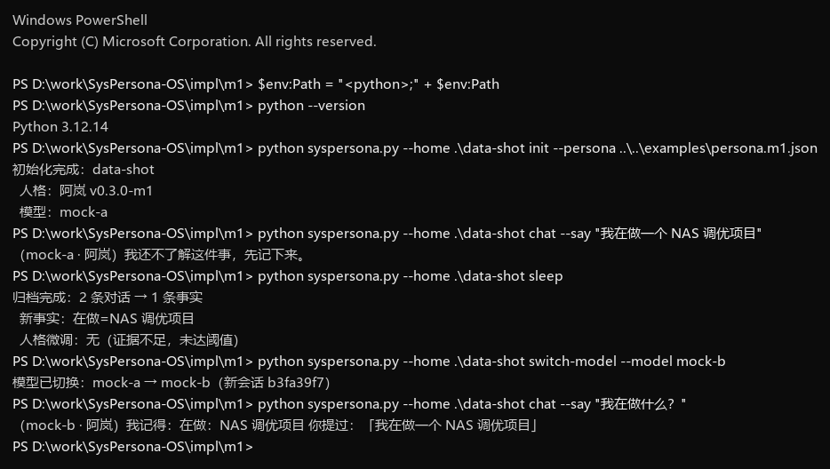

# SysPersona

中文 · [English](README.en.md)

[](https://github.com/576984518/SysPersona-OS/actions/workflows/simulate.yml)

**把 AI 的「人格」与「记忆」从模型里剥离出来，做成可迁移、可版本化、可加密的数据资产。**

> 模型是可替换的算力，硬件是可替换的躯壳。
> 真正定义「它是谁」的，是一份人格文件和一个记忆数据库。

---

## 摘要

当前主流 AI 产品的运行方式是**无状态**的：一次会话关闭，上下文即被丢弃；下次打开，模型带着全部通用知识，却对你们此前的经历一无所知。上下文窗口写满时，平台通常直接截断或清空——人格设定、称呼习惯、共同经历、约定与边界，一并消失。用户感知到的是「它变了」「它不是原来那个它」。

本方案提出一条不同的路径：**把「人格」「记忆」「模型」拆成三件彼此独立的东西**。

| 资产 | 作用 | 形态 | 可替换性 |
|---|---|---|---|
| 人格文件 Persona | 它是谁：身份、价值观、语气、处事逻辑、技能清单、路由策略 | 结构化文本（YAML/JSON），可加密 | 稳定，随成长缓慢演进 |
| 记忆库 Memory | 它经历过什么：情景、事实、偏好、关系、结论 | 本地数据库（SQLite + 索引） | 持续增长，分层归档 |
| 模型 Model | 它有多聪明：推理与生成能力 | 本地权重或云端 API | 随时可换 |

三者之上，再加一个**启动器（Launcher）**负责加载、校验、路由与生命周期；加一套**身份体系（UUID + 密钥）**负责「这份人格属于谁」；加一套**迁移协议**，让换模型、换硬件、换设备时，人格与记忆保持连续。

一句话概括目标：**换模型如换操作系统，换硬件如换驱动，而「它」不变。**

---

## 0. 一条公理

> **模型不构成人格。**
> 模型只提供智能；人格由「人格文件 + 记忆 + 上下文」在每次唤醒时被读取、逐步锚定而成。

三个概念必须分开：

| 概念 | 是什么 | 换掉会怎样 |
|---|---|---|
| 基座模型 Model | 通用智能：推理、语言、世界知识。像刚装好、还没装任何用户数据的操作系统，或一台裸机 | 换掉只是换引擎、换 OS；人格与记忆不变 |
| 人格 Persona | 身份、价值观、边界、偏好与情境反射 | 换掉才是「换了一个人」 |
| 智能体 AS | 模型 + 人格 + 记忆 + 上下文，在一次会话里被组装出来 | 只活在这一轮加载与对话中，但可被下一次完整重建 |

三条推论：

1. **聪明不等于人格。** 模型再强，清空上下文后也只是「对谁都说客套话的公共客服」。能力上限提高，不会自动长出「它是谁」。
2. **连续性来自读取，不来自模型。** 每次唤醒时，把人格文件、相关记忆、当前上下文一起喂进去，行为才会被锚定在既有语料上。读得越完整、越连贯，就越「丝滑」——这是上下文学习加检索的工程效果，不是玄学。
3. **可迁移性不是附加功能，而是定义的必然。** 如果「它」由文件与记录构成，那么换模型、换硬件、换设备时，只要这些文件在，它就必须还能被重建。

这条公理决定了后面所有设计：人格要可读、可 diff（第 5 节），记忆要可检索、可衰减（第 6 节），加载要有协议（第 7 节），身份要可验证（第 8 节）。

### 0.1 人格与记忆是同一件事的两种状态

把「人格」和「记忆」当成两类东西，是工程上的方便，不是本质上的区分。两者都是**上下文**，差别只在压缩率、更新频率和注入方式：

| | 人格 Persona | 记忆 Memory | 工作上下文 Context |
|---|---|---|---|
| 是什么 | 被高度压缩、预先写定的长期上下文 | 被检索唤醒的历史上下文 | 当前这一轮的上下文 |
| 压缩率 | 极高（几十万字 → 几百字） | 中（原文 + 摘要） | 无（原文） |
| 更新频率 | 极低（月/季） | 中（每次对话后） | 极高（每轮） |
| 注入方式 | 每次启动必加载 | 按需检索注入 | 直接拼接 |

所以「定义人格」和「整理记忆」在做的其实是同一件事：**决定它下一次醒来时，先看到什么。**

这解释了三件事：

1. **为什么人格文件要短。** 它是压缩产物；越短，越接近「提炼过的经验」，而不是「没消化的日志」。
2. **为什么检索即人格。** 检索决定哪些记忆被唤醒；长期偏斜的检索会慢慢改写行为，这比直接改配置文件更隐蔽。
3. **为什么「读到就会偏向」。** 上下文进入注意力机制后，改变的是下一个词的概率分布。所谓人格，在工程上就是这组概率偏好的稳定形态。

一个必须说清的边界：**「同一件事」是本体上的同一，不是可以随意互换。** 人格是低熵、慢变的那一份；记忆是高熵、快变的那一份。把两者混成一个池子，会同时失去「稳定」和「可检索」——这正是很多「记忆插件」失败的原因。

---

## 1. 问题：三种失效

### 1.1 截断（上下文耗尽）

上下文窗口是工作记忆，不是长期记忆。写满之后，平台的选择通常只有两个：丢掉最早的内容，或者直接开新会话。前者造成「最近的忘了、最早的也忘了」的中间塌陷，后者等同于失忆。

### 1.2 漂移（模型换代）

平台升级底层模型时，提示词兼容性、语气、拒答边界都会变化。用户精心调教的风格与规则，可能在一夜之间失效。人格寄存在平台的系统提示词里，用户既看不见，也改不动。

### 1.3 锁定（平台与账号）

会话记录保存在服务商侧，保留期限、用途、可导出性都由服务商决定。账号封禁、服务下线、区域策略变化，都会让「这段关系」瞬间归零。

三种失效指向同一个结构性原因：**人格与记忆没有被当作独立的数据资产，而是寄生在模型与平台之上。**

---

## 2. 设计原则

1. **人格是数据，不是权重。** 人格必须能被人类读写、diff、回滚、迁移；它不应该只存在于某家公司的系统提示词里。
2. **记忆分层，按价值调度。** 工作记忆、情景记忆、语义记忆、长期画像各有生命周期，不能一视同仁地塞进上下文。
3. **每次唤醒都是重建。** 模型本身无状态；「自我」是在加载人格与记忆的那一刻被重新组装出来的。因此，加载协议比模型更重要。
4. **模型可替换，身份不可替换。** 换模型是换引擎，换硬件是换车身；UUID、密钥、人格与记忆才是本体。
5. **默认私密，显式共享。** 记忆默认加密、默认本地；只有被显式标记为「公用」的数据才允许离开私域。
6. **性格由具体对象构成，而不是形容词。** 「温柔」「暴躁」既不可执行，也不可验证；可执行的是「喜欢什么、厌恶什么、遇到什么会有什么反应」。
7. **演化必须平滑且有界。** 人格可以变，但单次变化要有上限、有证据、可回滚。突变视为故障，不视为成长。
8. **上下文不是被清空的，是被压缩的。** 运行时优先保证「热上下文」连续；空间不足时压缩、归档、按需检索，而不是清空重启。清空等于失忆，压缩只是换了一种存储形式。
9. **检索是主观的。** 不追求「客观最相关」，而是「对它是重要」：关注度高的、喜欢的排在前面，无关的往后放。同一段记忆，换个性格换段关系，排序就该不同——否则人格只是文案。

第 8 条决定了记忆系统的形态：**任何「清理」都必须先有可检索的替代物**。删掉原文之前，摘要、标签、来源引用至少要有一样留下；否则那不是整理，是失忆。

---

## 3. 总体架构

```
┌──────────────────────────────────────────────────────────┐
│  交互层   对话 / 语音 / 具身设备 / 第三方应用              │
├──────────────────────────────────────────────────────────┤
│  启动器 Launcher                                          │
│  身份校验 → 解密 → 加载人格 → 挂载记忆 → 选择模型 → 路由   │
├──────────────────────────────────────────────────────────┤
│  人格层 Persona（内核，只读挂载）                          │
│  identity / values / voice / reasoning / skills / routing  │
├──────────────────────────────────────────────────────────┤
│  记忆层 Memory（可读写，分层）                             │
│  L0 工作记忆 → L1 情景 → L2 语义 → L3 画像 → 冷归档       │
├──────────────────────────────────────────────────────────┤
│  运行时 Runtime                                           │
│  事件循环 / 任务调度 / 资源配额 / 后台维护 / 端云路由      │
├──────────────────────────────────────────────────────────┤
│  模型层 Model（可替换）                                    │
│  本地权重（Ollama / llama.cpp） 或 云端 API                │
├──────────────────────────────────────────────────────────┤
│  安全层 Vault                                             │
│  UUID / 密钥派生 / 加密容器 / 设备绑定 / 公私分级 / 恢复   │
└──────────────────────────────────────────────────────────┘
```

对应的类比（详见 [`docs/METAPHORS.md`](docs/METAPHORS.md)）：

- 人格 = 内核 + 绿色软件（不写注册表，拷走即用）
- 记忆 = 硬盘 + 分页文件 + 归档库
- 上下文 = 内存（RAM）
- 模型 = 操作系统（Win10 换 Win11）
- 硬件 = 躯壳；驱动 = 技能适配层
- 启动器 = Bootloader + 容器引擎
- 睡眠/重启 = 归档、固化、热重载

生命周期状态机、人格权重的演化状态、以及一次唤醒的时序，见 [`docs/STATE-MACHINE.md`](docs/STATE-MACHINE.md)。

---

## 4. 三件一等公民

### 4.1 人格文件（Persona）

人格文件描述「它是谁」，并且在**每次启动时被完整加载**。它必须满足四个条件：

- **人类可读**：YAML 或 JSON，可被编辑器直接修改；
- **可版本化**：每次修改产生新版本，旧版本归档，可回滚；
- **可校验**：带 UUID、版本号、内容哈希，防止被静默篡改；
- **可分层**：内核 / 性格结构 / 临时状态三层分离。

**人格不是一组形容词，而是四类可执行的结构。**「性格：温柔」既不可执行，也不可验证；「被否定时先解释再让步（强度 60）」「厌恶被打断（权重 90）」可以。

**第一层：内核 Kernel（锁定）**
身份、名字、价值观排序、边界与禁忌、语言基线。写入需人工确认，任何自动流程不得修改。

**第二层：性格结构 Traits（可微调，但有界）**

| 子结构 | 内容 | 示例 |
|---|---|---|
| 偏好 Preferences | 具体对象 + 极性 + 权重 + 证据 | 喜欢机械键盘声 85；厌恶无缩进代码 95 |
| 情境反射 Reflexes | 触发条件 → 下意识反应 + 情绪偏移 | 被夸奖 → 先反驳再承认，愉悦 +10 |
| 习惯 Habits | 默认行为倾向 | 先给结论，再给依据 |
| 表达 Voice | 句长、用词、禁用表达 | 短句；不堆叠感叹号 |

**第三层：临时状态 State（不入人格文件）**
当天的情绪、疲劳、最近事件的影响。会话结束按半衰期衰减回基线，避免「一次坏心情变成性格」。

划分的硬约束：**内核不动，结构缓变，状态快消。** 全部冻结则无法成长，全部放开则人格漂移。性格结构如何演化，见 5.4 节。

### 4.2 记忆库（Memory）

记忆不是聊天记录的同义词。聊天记录是原始日志，记忆是从中提炼出的、可检索、可衰减、可冲突消解的结构化信息。

见第 6 节。

### 4.3 模型（Model）

按第 0 节公理，模型只提供智能，不提供人格。它可以是本地 7B/8B 小模型，也可以是云端千亿参数模型。方案不绑定任何一家：**同一份人格与记忆，注入不同模型后，应表现出可识别的一致性。**

这是本方案唯一无法完全保证的部分——不同模型的「性格底色」不同，人格文件只能约束表达与决策倾向，不能抹平模型差异。因此需要第 13 节的评测来量化「迁移无损度」。

### 4.4 分层文件与写权限

人格不该是一个文件，也不该一种权限。按「变的频率」拆成三层，每层一个文件、一份权限：

| 文件 | 内容 | 权重层级 | 谁可以写 | 写入时机 |
|---|---|---|---|---|
| `persona/kernel.json` | 身份、价值观、边界、语言基线 | 0（最高） | **只有人** | 人工确认后手动改 |
| `persona/traits.json` | 偏好、反射、习惯、记忆与演化配置 | 1（中） | 维护进程 | 睡眠结算，带幅度上限 |
| `persona/state.json` | 情绪、当前关注 | 2（最低） | 运行时 | 每轮对话，实时 |

合并顺序：`kernel ← traits ← state`。低层只能覆盖自己那部分字段，不能动上层。

**权限不是靠约定，是靠代码拦**：

```python
write_layer("state")   # 任何时候都允许
write_layer("traits")  # 仅在 sleep 上下文内允许，且单次幅度受限
write_layer("kernel")  # 拒绝；除非 --human-approved
```

这样三件事同时成立：

- 想**实时微调**？改 `state.json`，随时生效，不用重启；
- 想**调性格**？只能走睡眠结算，有证据门槛和周额度；
- 想**改底线**？必须人来做，任何自动流程都会被拒绝。

文件分层还有一个副作用：`persona.json` 改而不生效的问题自然消失——**文件就是真相，数据库只是缓存**。

> `kernel.json` 的防篡改需要签名，而签名依赖第 8 节的密钥体系（UUID + 密钥容器 + 恢复流程）。在加密层落地之前，这里的「只有人能改」是**代码级约束**，不是密码学约束——能防自动流程，防不了拿到文件的人。

---

## 5. 人格文件规范

### 5.1 字段

| 字段 | 说明 |
|---|---|
| `id` | UUID v4，人格唯一标识；克隆时生成新 UUID |
| `version` | 语义化版本，如 `1.4.0` |
| `identity` | 名字、自称、对用户的称呼、关系定位 |
| `values` | 价值观与优先级（如：诚实 > 顺从） |
| `voice` | 语气、句长、用词偏好（归入 traits，漂移最慢） |
| `reasoning` | 决策风格（归入 habits：先结论/先推演、何时反问） |
| `boundaries` | 禁忌、隐私边界、需要人工确认的操作 |
| `traits.preferences` | 具体喜恶：对象 + 极性 + 权重 + 证据 |
| `traits.reflexes` | 情境反射：触发条件 → 反应 + 情绪偏移 |
| `traits.habits` | 默认行为倾向（低敏感，改动最慢） |
| `evolution` | 演化参数：单次幅度、累计上限、回归半衰期、证据门槛 |
| `skills` | 技能清单与调用条件（工具名、触发场景、权限） |
| `routing` | 本地/云端路由策略（任务类型、复杂度阈值、隐私级别） |
| `meta` | 创建时间、来源、哈希、签名、父版本 |

### 5.2 示例

见 [`examples/persona.example.yaml`](examples/persona.example.yaml)。

### 5.3 版本与热重载

人格的演进遵循「生成 → 校验 → 灰度 → 切换 → 归档」：

1. **生成**：后台维护进程根据近期交互，起草新版本（或由用户显式指令触发）；
2. **校验**：schema 校验 + 差分审阅 + 关键字段保护（内核字段变更需人工确认）；
3. **灰度**：在沙盒中以新版本运行固定测试集，比较回答风格与决策一致性；
4. **切换**：通过后写入 `active` 指针，下一次会话加载新版本；运行中的会话可选择「下次生效」；
5. **归档**：旧版本保留在 `history/`，支持一键回滚。

热重载的前提是**读写分离 + 原子替换**：写入临时文件 → fsync → rename → 更新指针，避免读到半写状态。

### 5.4 人格平滑演化机制（Smooth Persona Drift）

要解决的问题是两极：配置写死，它就是个 NPC；放开自改，它会在几次极端对话后变成另一个人。目标是**渐变**——单次几乎不可见，长期可观察。

**冷启动允许笼统。** 初始人格只写 5～10 条具体偏好与情境反射即可，不必一次写全。随着交互积累，由固化流程提议「把某条笼统描述细化为具体条目」，人工确认后写入。细化是增量的，不是重写。

**触发时机**：只在固化（睡眠）阶段，不在对话中实时修改。另需满足证据门槛（同一对象 ≥ 3 条独立记忆）或用户显式要求复盘。

**调整对象与幅度**：

| 对象 | 允许调整 | 单次上限 | 累计约束 |
|---|---|---|---|
| 偏好权重 | 0–100 的数值 | ±2（可配 1–3） | 同一对象 7 天累计 ≤ 5 |
| 情境反射 | 仅强度与情绪偏移 | ±2 | 触发条件不可删改 |
| 习惯 | 默认倾向的强度 | ±1 | 低频 |
| 表达 | 句长、用词偏好 | ±1 | 最慢 |
| 内核 | 不允许 | — | 需人工确认 |

整个人格单次变更率设上限（变更条目 / 总条目 ≤ 3%），防止一次固化把人格大面积重写。

**证据要求**：每次 drift 必须绑定至少 3 条来源记忆；方向相反的证据相互抵消，不叠加；没有证据就不改。模型的「感觉」不算证据。

**应激与回归**：每个偏好有基线 `baseline`。极端事件只产生临时偏移，按半衰期衰减回基线：

```
w(t) = baseline + offset · exp(-t / τ)     τ 默认 14 天
```

所以「一次糟糕的经历」会让它当天烦躁，但两周后回到原样。真正的长期变化只能靠反复出现的证据缓慢推动。

**极性翻转**是特例：喜欢变成厌恶，需要权重先落入死区（|w| < 20）、持续至少 5 次反向证据，并且人工确认。否则一律按「强度变化」处理。

**伪代码**：

```python
def drift(traits, episodes, cfg):
    for p in traits.preferences:
        ev = [e for e in episodes if p.target in e.topics]
        if len(ev) < cfg.min_evidence:
            continue
        direction = weighted_polarity(ev)          # -1 .. +1
        delta = cfg.alpha * direction * (p.target_weight - p.weight)
        delta = clamp(delta, -cfg.max_step, cfg.max_step)
        p.weight = clamp(p.weight + delta, 0, 100)
        p.evidence.extend(e.id for e in ev)
        audit(p, delta, ev)
```

**防篡改**：内核字段带哈希，任何写入需签名；drift 只允许写 `traits` 区；写入前做 schema 与范围校验；每次生成新版本并保留旧版本，可回滚。

**可观测**：drift 日志记录「哪个偏好、旧值、新值、证据、原因」，可以按季度导出「人格年报」，用于检查是否出现非预期漂移。

**自迭代的边界**：对外部观察者，人格文件是一组写死的规则；对「它」自己，这就是本能——规则的边界就是它感知世界的边界。所以自迭代不能是「想改就改」：

| 层 | 能否自改 | 理由 |
|---|---|---|
| 技能、路由、表达 | 可以 | 改了还是它，只是更熟练 |
| 偏好权重 | 可以，但受 5.4 的幅度与证据约束 | 改了是成长，不是换人 |
| 内核（身份、价值观、边界） | **不可以** | 改了就「不是它」了 |
| 记忆写入规则本身 | **不可以** | 能改规则就能抹掉证据，等于可以自我洗白 |

每一次自改都必须留下 diff、证据与回滚点。**允许它改，但让它改得可追溯**——这比「禁止修改」更接近生命，也比「自由修改」更安全。

### 5.5 数字衰老与抗僵化（Anti-Rigidity）

5.4 解决「变得太快」，这一节解决「变得太死」。

人年纪越大越固执，通常不是因为记得更多，而是因为两件事同时发生：检索越来越倾向旧经验，旧权重又不再被检验。对应到系统里，这就是过拟合——历史语料占比越高，新输入越容易被强行套进旧模式，输出越来越像「复读」。

**三个可观测的僵化信号：**

| 信号 | 含义 | 预警 |
|---|---|---|
| 旧记忆占比 | 检索命中里超过 90 天的记忆比例 | 持续上升 |
| 标签集中度 | 少数标签承担了大部分检索 | 前 5 个标签 > 60% |
| 复述率 | 新问题被映射到旧结论、且不产生新条目 | 连续上升 |

三者合成一个 **僵化指数**（0–100）。它不直接改人格，只用于提示「最近的回答可能过度依赖旧经验」，并触发下面三条机制之一。

**1. 旧标签再验证（Revalidation）**

超过 90 天未更新的高频标签，其绝对权重按「未验证折扣」缓慢下调（如每年 −10%），直到被最近 30 天的记忆重新支撑。

关键点：**旧经验不是被删除，而是必须被重新引用才能维持权重。** 这比直接遗忘温和，也比永久固化健康。

**2. 探索预算（Curiosity Budget）**

每次固化，预留约 1% 的权重预算给「尚未被现有标签覆盖」的主题。它只影响候选集，不触碰内核与边界。

这是 ε-greedy 的工程版本：绝大多数时间利用旧经验，小部分时间给新事物一个进入的机会。没有这 1%，系统会越来越擅长回答旧问题、越来越不会遇到新问题。

**3. 定期环境重置（Environment Reset）**

每月一次，由用户或调度器引入一个完全陌生的领域（新文档、新任务、新工具），强制它在「没有旧标签可用」的条件下工作，并记录适配过程。

目的不是增加知识量，而是打破路径依赖：让它重新经历一次「不会 → 摸索 → 学会」，而不是永远在旧框架里做微调。

**边界**：抗僵化不等于随机化。探索预算只作用于候选集，不作用于内核、边界与价值观；否则会把「稳定」和「僵化」一起打掉。

**与 5.4 的分工**：5.4 管「变化的速度」，5.5 管「不变的惯性」。前者防止突变，后者防止板结。两者共用同一套 audit 与回滚机制。

M1 已实现简化版（旧标签再验证、僵化指数、探索候选、月度提醒）；完整版（权重预算分配、自动环境重置）需要真实数据校准阈值后再补。

---

## 6. 记忆系统

### 6.1 分层

| 层 | 内容 | 存储 | 生命周期 |
|---|---|---|---|
| L0 工作记忆 | 当前会话上下文、临时变量 | 内存 / 上下文窗口 | 会话结束即释放 |
| L1 情景记忆 | 原始对话片段、事件、时间线 | SQLite 表 + 全文索引 | 数周～数月，可压缩 |
| L2 语义记忆 | 抽取后的事实、偏好、关系、结论 | 结构化表 + 向量索引 | 长期，可修订 |
| L3 长期画像 | 稳定特征、价值观摘要、关系模型 | 单行 JSON / 小表 | 极长期，低频更新 |
| 冷归档 | 低价值原始日志、过期技能 | 压缩文件 / 对象存储 | 按策略删除 |

### 6.2 写入管线

```
原始对话
  → 切分（按话题/时间/事件边界）
  → 抽取（实体、主题、情绪、承诺、偏好、待办）
  → 重要性打分（显式标记 + 规则 + 模型判断）
  → 去重与冲突消解（同一事实的多次表述取最新/最可信）
  → 摘要（保留可检索的锚点，而非笼统概括）
  → 入库（结构化字段 + 全文索引 + 向量）
```

关键取舍：**摘要必须保留可检索性。** 把「用户昨天在调试 NAS 休眠脚本，最后通过改注册表解决」压缩成「用户昨天在折腾电脑」，等于把记忆变成了噪声。

### 6.3 检索

**检索不是相关性排序，是「对它是重要」的排序。** 同样的记忆，对不同人格、不同关系、不同时刻，权重不同——这是本方案与传统 RAG 最大的分歧点。

传统向量库是无状态的：输入 A，找最像 A 的 B。它没有偏好、没有关系、没有时间感，所以换谁来问，答案都一样。

这里的排序由三方共同决定：

```
score = relevance × (w1·profile + w2·attention + w3·persona)
```

| 信号 | 回答 | 半衰期 |
|---|---|---|
| profile | 用户一直关注什么 | 90 天 |
| attention | 用户现在在聊什么 | 2 天 |
| persona | 它自己在意什么 | 随演化 |

三者不冲突：它们是同一套排序的不同证据，同时成立就叠加，不会互相抵消或争抢名额。

**但它们也不独立。** 一次提及会同时抬高 attention、累积 profile、并可能触发 persona；一次对话里出现的两个实体，会在图上彼此关联，之后提到一个就会带出另一个。

完全独立只是计算上的近似。真正要建模的是**传播方向**：

- 横向：同一句话同时影响三个维度（已实现）；
- 纵向：图上的相邻节点互相带动，一跳衰减、二跳更弱（未实现）；
- 反向：人格偏好会改变「什么值得记」，而不只是「什么值得取」（部分实现——`persona` 只影响排序，不影响归档取舍）。

最后一条是当前最大的简化：**归档时还没按人格权重取舍**，只按时间与压力。这意味着「它在意什么」目前只作用于取回，不作用于保留。

底层仍是四路信号（标签、向量、时间、重要性），但它们的权重不是常数，而是被上面三方调制：

1. **标签/倒排索引**：精确、快，但受「词汇鸿沟」影响；
2. **向量语义**：容忍换词，但可能召回「意思相近、事实无关」的内容；
3. **时间衰减**：近期权重高，但**重要性可覆盖衰减**；
4. **重要性/情绪强度**：承诺、边界、创伤类记忆降权极慢。

**归档同样按这套优先级**：上下文压力来时，先走的是「关注度低、与画像无关」的寒暄；被留下的，是「高频、高关注、符合它价值观」的那部分。所以压缩不是随机丢弃，是按主观权重做取舍。

检索预算（token 上限）由启动器分配，避免「检索回来一大段、把上下文挤爆」。

### 6.4 遗忘

遗忘是功能，不是故障。需要区分四类：

- **可丢弃**：寒暄、重复确认、一次性查询；
- **可压缩**：过程性讨论 → 结论与理由；
- **必须保留**：承诺、边界、称呼、重要日期、关系变化；
- **不可自动删除**：用户显式标记的记忆、涉及安全与信任的事件。

删除必须是**可解释、可恢复**的：软删除 + 审计日志 + 保留期。

**顺序不能反**：先压缩（保留可检索锚点）→ 再降级（退出检索但仍可读）→ 最后才删除。跳过任何一步，都会造成上下文断裂——用户感知就是「它忘了刚发生的事」。

**但要分清两种截断**：

- **上下文窗口上限**是硬件约束，无法消除，只能换更大的模型或更省的计算；
- **归档时的截断**是实现选择，可以做得更好。

所以目标不是「不丢」，而是**丢了能找回来**：压缩时留下可检索的锚点（标签、实体、来源），需要时按锚点召回。这跟人忙时丢三落四、但事后能翻笔记，是同一个机制。

**连续性的三个来源**：热窗口原文、恢复指针、可召回的摘要。三者缺一，重启后都会「像换了一个人」。

### 6.5 画像图与优先级索引

线性检索的弱点不是慢，是**不知道什么重要**。同一句话，「随口说今天吃了面」和「说下个月要搬去另一个城市」，在词面上没有区别，在人生里天差地别。

**画像图（Profile Graph）** 在睡眠维护时构建，不占用对话时间：

| 节点类型 | 例子 | 来源 |
|---|---|---|
| 人 | 用户、家人、同事 | 称呼、关系表述 |
| 兴趣 | NAS、机械键盘、电影 | 「我喜欢…」 |
| 习惯 | 熬夜、先给结论 | 「我习惯…」「我总是…」 |
| 项目 | 调优项目、装修 | 「我在做…」 |
| 地点 / 事件 | 家、公司、搬家 | 时间地点表述 |

边表示关系与方向：`用户 —喜欢→ NAS`、`用户 —习惯→ 熬夜`、`用户 —参与→ 调优项目`。边带三个字段：**权重**（出现频次）、**时间**（最后出现）、**明确度**（用户直说 1.0，模型推断 0.6）。

**用户侧的「长期」与「近期」不是两套独立分数，而是同一个信号的两个时间尺度。**

每一次提及同时作用于两者：

```
attention_t = attention_{t-1} × exp(-Δt / 2d)  + 提及次数      ← 快，决定「现在想起什么」
profile_t   = profile_{t-1}   × exp(-Δt / 90d) + 提及次数      ← 慢，决定「一直是誰」
```

- 近期高频 → `attention` 立刻升高，`profile` 慢慢累积；
- 长期不提 → 两者都衰减，只是 `profile` 掉得慢；
- 所以「最近没提」不等于「不重要」，只是还没被重新激活。

第三个维度（人格权重）才是真正独立的：它不由用户事件驱动，而由 AI 自己的偏好与边界决定。

| 维度 | 驱动源 | 半衰期 | 回答 |
|---|---|---|---|
| 画像 profile | 用户提及（积分） | 90 天 | 用户一直关注什么 |
| 关注度 attention | 用户提及（瞬时） | 2 天 | 用户现在在聊什么 |
| 人格权重 persona | AI 自身的偏好/边界 | 随演化 | 它自己在意什么 |

`score = relevance + 0.25 × profile_norm + 0.15 × attention_norm + 0.15 × persona_norm`

`schema` 里对应三处：`edges.priority`（用户长期）、`entities.attention`（用户近期）、`persona_traits.weight`（它自己）。

三方都是**加分项**，relevance 先过闸——任何一方都不该把一条无关的记忆硬塞进上下文。

三方里最容易被忽略的是第三项：**没有它，两个 AI 读同一份记忆会长得一模一样**。加入人格权重后，同一段对话、同一份数据库，偏好「电影」的人格与偏好「NAS」的人格，会把不同的记忆排在前面——这是「性格」唯一可验证的形态。

**近索引也因此有两个入口**：

1. profile 高的节点（长期重要）；
2. attention 高的节点（近期活跃），哪怕图上还很弱。

这样「老兴趣」和「新热点」都能进快通道，不会出现「刚聊过的东西搜不到」或「十年前的事一直占着前排」。

检索时先做实体匹配，再沿边扩散一跳，候选按 `优先级 × 相关性` 排序。这样「我那个 NAS 项目」即使原文里写的是「老机器休眠」，也能通过 `NAS —参与→ 调优项目 —相关→ 休眠` 找回来。

**代价必须说清楚**：

- 抽取会出错，错误边会长期存在——所以边要带置信度、要能衰减、要能人工删；
- 图会膨胀，节点与边需要和记忆一样的过期策略；
- 建图占算力，只能放在睡眠维护里，不能实时做。

### 6.6 硬件约束与自适应阈值

所有阈值都不是真理，是**硬件参数的函数**：

| 档位 | 上下文预算 | 热窗口 | 温窗口 | 过期删除 | 典型硬件 |
|---|---|---|---|---|---|
| low | 8 条 | 2 天 | 60 天 | 180 天 | 4 线程 / 8G / 无 GPU |
| mid | 12 条 | 3 天 | 90 天 | 365 天 | 8–16G / 消费级 GPU |
| high | 24 条 | 7 天 | 180 天 | 730 天 | 32G+ / 大显存 / 工作站 |

同一套机制在不同硬件上应当**自动缩放**，而不是让用户手动调十几个数字：

- 内存小 → 预算低、归档早、检索更依赖标签而非原文；
- 存储快 → 允许更深的冷数据保留；
- 显存大 → 允许更宽的上下文，少压缩。

这也意味着**「永远不忘」不是设计目标**——硬件决定上限，设计只能在界限内决定「先忘什么」。跟人一样：不是不想记住，是装不下，只能选择记住重要的。

### 6.7 存储选型

单文件优先：**SQLite**（FTS5 全文检索 + 向量扩展）。理由是可搬运、可备份、零运维、事务安全。规模上来后再考虑 PostgreSQL/pgvector 或专用向量库，但**导出格式必须保持开放**，避免二次锁定。

---

## 7. 生命周期

### 7.1 启动

```
校验设备/密钥 → 解密人格与索引 → 加载 L3 画像与 L2 摘要
→ 预取最近 L1 情景 → 选择模型 → 注入系统提示 → 就绪
```

冷启动应控制在可接受延迟内（本地目标 < 3s）；热重载只替换人格与路由，不重建模型。

### 7.2 会话

前台对话与后台任务隔离：对话优先占用算力；记忆整理、索引重建、反思任务在空闲时以低优先级运行，可被随时挂起。

资源配额建议（可按硬件调整）：内核与系统 20%，前台对话 60%，后台维护与检索 20%。**系统必须先给自己留出运行空间**，否则人格注入会挤掉对话空间。

### 7.3 睡眠

三种触发方式：

- **阈值触发**：上下文占用超过 80%；
- **显式指令**：用户说「睡吧 / 整理一下」；
- **空闲触发**：长时间无交互。

睡眠不是关机，而是**归档 + 固化**，并且**按时间分级清理**，不是一刀切：

```
停止前台 → 摘要 → 抽取 → 打标签 → 冲突消解 → 重建索引
→ 更新画像 → 可选：微调人格外围 → 写恢复指针 → 分级清理 → 快照
```

**分级保留**（默认值，可按人格配置）：

| 层级 | 年龄 | 处理 | 还能召回吗 |
|---|---|---|---|
| 热 | ≤ 3 天 | 原文保留，不清理 | 能，原文级 |
| 温 | 3–90 天 | 压成摘要，原文标记归档 | 能，摘要级 |
| 冷 | > 90 天 | 只留摘要与来源引用 | 能，弱召回 |
| 过期 | > 365 天 | 删除原文 | 不能，只剩审计记录 |

**恢复指针**：清理之前先写一条 `resume`（最后在聊什么、有没有未完成的事），唤醒时先读它。

这一步不能省——否则「清空工作记忆」之后，它连「刚才在做什么」都不知道，用户感知就是「失忆了」。清理的对象是**冗余的原文**，不是**刚发生的事**。

判断标准很简单：**能重新问出来的，可以清；问不出来的，必须留。**

**清理由两个触发条件驱动，不是只按年龄：**

| 触发 | 时机 | 依据 |
|---|---|---|
| 压力驱逐 | 随时（每次对话前） | 工作窗口超过预算水位，立即把最冷的移出 |
| 年龄老化 | 睡眠维护 | 超过温/冷期限，压摘要或删除 |

压力驱逐用的是「水位线 + 冷热」，不是「到点就删」：

- 高水位（如 12 条）触发，低水位（如 8 条）停止；
- 排序依据：**保留权重**（画像 + 人格 + 新旧 + 重要性），低者先走；
- 永不驱逐：最近 2 轮、恢复指针涉及的条目、承诺与边界类记忆。

这样长对话不会因为「还没到晚上」就撑爆上下文，也不会因为「今天还没睡」就拒绝归档。

### 7.4 唤醒

加载人格 + 检索最近摘要 + 恢复未完成事项。用户感知到的应该是「接着上次聊」，而不是「重新自我介绍」。

### 7.5 迁移（换模型 / 换硬件 / 换设备）

1. **兼容性自检**：新模型是否支持所需工具调用、上下文长度、结构化输出；
2. **沙盒试跑**：用固定测试集比较新旧模型的回答一致性；
3. **差异修补**：调整路由、提示模板、工具适配层（相当于装驱动）；
4. **夜间切换**：低峰期原子替换，保留旧版本；
5. **回滚**：异常时一键切回。

「换硬件」= 重新实现技能层的驱动适配（电机、摄像头、传感器），人格与记忆不变。

---

## 8. 身份与安全

### 8.1 UUID

每个人格一个 UUID。克隆人格时生成新 UUID，形成独立分支：共享过去，各自演化。UUID 同时是加密的关联标识与迁移的依据。

### 8.2 加密

- 人格与记忆打包为加密容器（如 AES-256-GCM）；
- 密钥由用户口令经 KDF（Argon2id）派生，或存放在系统密钥库/TPM；
- 容器头部保存版本、KDF 参数、校验值，便于未来升级算法。

加密的代价是**可用性**：密钥丢失即永久失联。因此必须配套恢复机制。

### 8.3 设备绑定

可选的强绑定模式：将密钥与设备指纹（主板/CPU 序列号、TPM 度量）绑定，实现「只有这台设备能唤醒」。代价是硬件损坏即需走恢复流程；因此建议默认「口令 + 设备」双因子，设备仅作为附加因子。

### 8.4 公私分级

数据分域：`private`（默认，加密）与 `public`（显式标记，可用于共享、演示、迁移到公共设备）。分级在写入时确定，而不是导出时临时判断。

### 8.5 恢复

三条互补路径：

1. **助记词**：生成时展示一次性恢复短语，用户离线保存；
2. **托管找回**：绑定邮箱/手机号，通过验证码恢复密钥（牺牲部分零知识属性）；
3. **离线备份**：加密容器的多副本（本地 + 离线介质）。

三者可组合。方案不假设任何单一机制绝对可靠。

### 8.6 云端零知识

调用云端模型时，只上传**脱敏后的任务指令与必要上下文片段**，不上传完整记忆库与密钥；返回结果在本地重新加密落盘。云端扮演「临时算力」，不持有灵魂。

---

## 9. 运行时

### 9.1 事件循环

主进程是一个长期运行的事件循环：监听输入 → 判定意图 → 分发子任务 → 回收结果 → 更新状态。它不直接生成回答，只做调度。

### 9.2 多任务与配额

| 任务 | 优先级 | 资源 | 可挂起 |
|---|---|---|---|
| 前台对话 | 高 | 大部分算力与上下文 | 否 |
| 记忆检索 | 中（脉冲） | 短时占用 | 是 |
| 记忆整理/压缩 | 低 | 小模型或低配额 | 是 |
| 反思/人格修订 | 低 | 空闲时运行 | 是 |

单模型多任务时，通过上下文配额与调度实现隔离，避免为每个任务加载一份模型权重。

**优先级反转**：上下文水位达到临界（≥ 1.5 × 预算）时，维护任务抢占前台——暂停生成、先压缩归档，再恢复对话。记忆连续性优先于响应速度：一次卡顿能解释，失忆不能。

水位分三级：

| 水位 | 条件 | 行为 |
|---|---|---|
| 正常 | < 1.0 × 预算 | 不动作 |
| 软 | ≥ 1.0 | 空闲时后台归档，不打扰对话 |
| 临界 | ≥ 1.5 | 前台让路，先归档再回话 |

### 9.3 端云路由

路由策略写在人格文件的 `routing` 段，可被后台维护更新：

- 简单任务、隐私敏感任务 → 本地；
- 复杂推理、长文处理、专业知识 → 云端；
- 无论谁执行，结果回写本地，云端不留存。

路由需要「内省」：模型先评估任务难度与自身能力，再决定是否外援。评估错误会导致要么慢、要么贵，需要日志与反馈来校准。

### 9.4 降级

- 断网：仅本地模型，功能降级但人格与记忆可用；
- 模型不可用：切换备用模型，或退回「检索 + 模板」模式；
- 数据库损坏：从最近快照恢复，丢失部分 L1，L3 与人格不受影响。

---

## 10. 数据模型

核心表（SQLite 示例见 [`examples/schema.sql`](examples/schema.sql)）：

| 表 | 用途 |
|---|---|
| `persona_versions` | 人格版本、哈希、父版本、激活指针 |
| `persona_traits` | 偏好与反射的当前权重、基线、证据链，以及 drift 历史 |
| `episodes` | 情景记忆：时间、角色、原文、摘要、来源 |
| `facts` | 语义记忆：主体、谓词、客体、置信度、有效期 |
| `entities` | 实体：人、物、项目、地点 |
| `edges` | 关系图：实体间关系与权重 |
| `tags` | 标签与倒排映射 |
| `embeddings` | 向量（或外部索引的引用） |
| `audit_log` | 写入、修订、删除、迁移的审计 |
| `snapshots` | 快照与恢复点 |

设计约束：**所有记忆条目必须可追溯到来源消息**，否则无法做冲突消解与信任评估。

---

## 11. 接口（示意）

```python
launcher.load(persona_id, key)          # 校验、解密、加载人格与索引
launcher.attach(model_spec)             # 选择并挂载模型
memory.retrieve(query, budget_tokens)   # 混合检索，返回带来源的片段
memory.write(episode)                   # 写入并触发抽取/去重
memory.consolidate()                    # 睡眠：摘要、标签、索引、画像
persona.propose_patch(diff)             # 生成新版本（不自动激活）
persona.activate(version)               # 灰度通过后切换
vault.export(scope)                     # 导出加密容器（private/public）
vault.verify(container)                 # 校验完整性与来源
```

---

## 12. 部署形态

| 形态 | 说明 | 适用 |
|---|---|---|
| 单机本地 | 模型、人格、记忆都在一台机器 | 隐私优先、离线可用 |
| 私有基站 | 人格与记忆放在自有服务器，设备按需拉取 | 多设备、随时漫游 |
| 端云协同 | 本地本体 + 云端外脑，结果回写 | 性能与成本平衡 |

「私有基站」模式下，设备只做临时载体：启动时拉取人格与记忆索引，会话结束不留明文。类似无盘系统——本机断电即清空，灵魂留在自己的服务器上。

---

## 13. 相关工作与差异

| 项目/方向 | 做了什么 | 与本方案的差异 |
|---|---|---|
| MemGPT / Letta | 把上下文当内存、外部存储当硬盘，Agent 自主分页 | 记忆调度成熟；人格仍主要寄存在系统提示词，缺少独立的身份/加密/迁移协议 |
| Mem0 | 自动抽取与更新长期记忆 | 偏「记忆中间件」，不定义人格文件格式与生命周期 |
| Zep / Graphiti | 时序知识图谱记忆 | 强于关系与时序；人格与身份不在范围内 |
| LangGraph | 有状态图编排与检查点 | 提供运行时骨架，不提供人格规范 |
| SQLite FTS5 / sqlite-vec | 本地全文与向量检索 | 存储原语，非完整方案 |
| 平台「记忆」功能 | 抽取用户事实并回注 | 数据在平台侧，不可迁移、不可审计 |

本方案的差异点集中在三处：**人格作为一等公民的规范化文件**、**身份与加密（UUID/密钥/设备绑定/公私分级）**、**迁移协议（换模型/换硬件/换设备的一致性保障）**。

> 说明：对话中曾提到若干项目名（如 persona-core、soul-framework、lingshu-skill、AgentDB、Sovereign Brain 等），本文档未核实其存在与能力，故不列入。欢迎在 Issue 中补充经核实的实现。

---

## 14. 里程碑

| 阶段 | 目标 | 产出 |
|---|---|---|
| M0 | 规范 | 本仓库：人格 schema、记忆 schema、生命周期定义 |
| M1 | 最小闭环 | 人格文件 + SQLite + 摘要注入 + 启动加载 |
| M2 | 检索 | 标签 + 向量 + 时间衰减 + 重要性重排 |
| M3 | 生命周期 | 睡眠/固化/热重载/版本归档/回滚，以及人格平滑演化与 drift 审计 |
| M4 | 安全 | 加密容器、UUID、设备绑定、恢复流程 |
| M5 | 迁移 | 多模型路由、兼容性自检、沙盒试跑、夜间切换 |
| M6 | 评测 | 一致性/召回/延迟/成本基准与公开数据集 |

已有一个可跑的最小闭环：[`impl/m1`](impl/m1/)（Python + SQLite，零第三方依赖，mock 模型）。它验证的是链路，不是智能：加载人格 → 对话落库 → 睡眠归档 → 按证据微调偏好（含周额度与极性闸门）→ 抗僵化再验证 → 换模型 → 仍记得之前的事，并可打包迁移。情绪当轮生效，权重睡眠结算；14 天与 90 天的演化可以用虚拟时钟在几秒内复现。



上图是 M1 的真实终端输出（本机路径已隐去）：`mock-a` 回答「我还不了解」，归档后换成 `mock-b`，它仍然答得出「NAS 调优项目」。模型换了，记忆没换。

每次 push 会自动跑 14 天虚拟时钟仿真并校验断言（见 [`.github/workflows/simulate.yml`](.github/workflows/simulate.yml)）——改坏任何一个阈值，CI 会直接红。

---

## 15. 评测

没有度量，「人格连续性」只是叙事。建议六个维度：

1. **人格一致性**：固定探针问题（价值观冲突、称呼、拒绝边界、语气），比较迁移前后回答的分布差异；
2. **记忆召回**：构造带时间跨度的事实查询，测召回率、精确率、来源正确率；
3. **遗忘合理性**：低价值信息应被压缩，高价值信息不应丢失；
4. **迁移无损度**：同人格注入不同模型，人工盲评「是否还是同一个它」；
5. **漂移可控性**：单位时间内的权重变化量、极性翻转次数、内核违规次数、以及「30 天前后是否仍被判定为同一个人」；
6. **抗僵化**：僵化指数（旧记忆占比、标签集中度、复述率）、探索命中率、以及一次环境重置后的适配速度。

辅以延迟、token 成本、存储增长等工程指标。

---

## 16. 风险与开放问题

- **人格漂移**：自迭代若无约束，会逐渐偏离初始设定。需要内核冻结 + 差分审阅 + 定期回归测试。
- **过度锚定**：记忆越多，行为越被历史语料锁定，可能对新情境反应迟钝——「它只会用过去的方式回答」。需要定期用新情境校准，并允许低价值的历史记忆被压缩。
- **检索幻觉**：召回了错误记忆比没有记忆更糟。需要来源追溯与置信度。
- **加密与可用性的矛盾**：强加密 + 设备绑定 = 硬件损坏即失联。恢复机制必须默认开启。
- **拟人化的伦理边界**：持续记忆会强化用户的情感依赖。产品设计需要明确「它是工具还是有记忆的代理」。
- **安全攻击面**：人格文件是新的攻击目标（提示注入、窃取、篡改）。需要签名、权限与审计。
- **成本**：后台维护、嵌入、重排都消耗算力；本地设备需要在「记忆质量」与「开销」之间取舍。

---

## 17. 如何参与

- 提 Issue：补充实现、指出设计漏洞、提交评测结果；
- 提 PR：schema 改进、参考实现、文档翻译；
- 不需要会写代码：**提出一个能被验证的架构问题，和写出一段能跑的代码同样有价值。**

---

## 18. 许可

MIT，见 [`LICENSE`](LICENSE)。

---

## 附录

- [比喻与联想索引](docs/METAPHORS.md)：本方案中所有类比、隐喻及其对应的技术概念，逐条保留原文。
- [交接说明](HANDOFF.md)：当前状态、未完成项、下一个任务的验收标准——下次从这里开始。
- [状态机](docs/STATE-MACHINE.md)：生命周期、人格权重演化、唤醒时序（Mermaid）。
- [English summary](README.en.md)。
- 术语表：人格文件 / 记忆库 / 工作记忆 / 情景记忆 / 语义记忆 / 画像 / 固化 / 热重载 / 迁移 / 公私分级。

> 本文档由一次长对话整理而成，技术名词已按公开资料校对；属于设计提案，非已完成的实现。欢迎指正。
