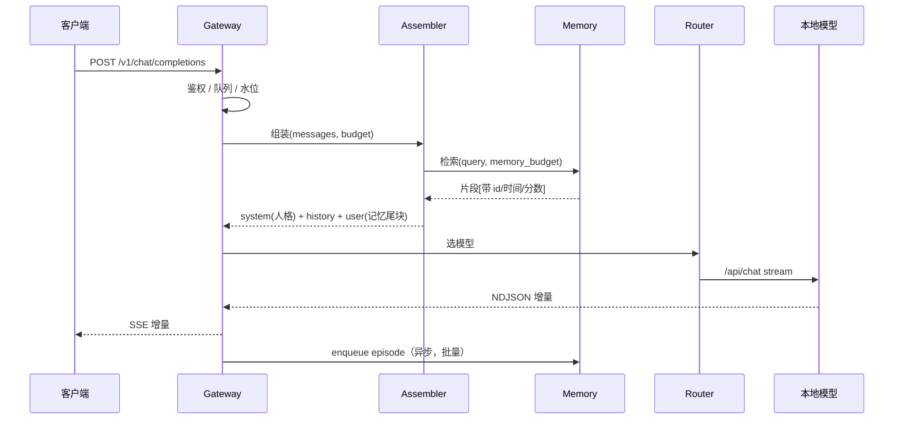

# SysPersona Runtime 参考实现（Annex A）

> **SysPersona-OS** · 本文件定义：Launcher 中间件附录：接口、错误码、部署形态
> 规范全文以仓库 `main` 为准；改了要同步 README / CHANGELOG / 台账。

> **Annex 说明**：本文件写于 Runtime 加入「能力面」之前，正文里的「Runtime」在早期版本叫「中间层」，已统一改名。
> 凡是与 `docs/LAUNCHER_SPEC.md` 冲突的地方，以规范为准；工具与媒体相关的部分见规范 §11。


> 性质：**Annex A（资料性）**。规范性文件是 [`LAUNCHER_SPEC.md`](LAUNCHER_SPEC.md)，本文回答的是"这套规范凭什么在 4 GB 机器上跑得动"。
> 发布：**v1.1.0**（2026-11-07）｜位置：`docs/MIDDLEWARE_LAUNCHER.md`
>
> 状态：方案冻结，等待实现。本文件定义「人格与记忆如何接上模型」，不含实现代码。
> 前置：v1.0.0 公理与 §3 总体架构、§4.4 分层权限、§6 记忆系统、§7 生命周期、§8 加密、§9 运行时。
> 本文件不新造密码学格式，容器与密钥体系直接复用 `docs/SECURITY_SPEC.md` 与 `impl/m4`。

---

## 0. 一页结论

**结论：可行。** 在 4 核 / 4 GB 的机器上，一个单进程、零第三方依赖（加密除外）的Runtime，可以把「启动加载 → 检索注入 → 流式转发 → 落库 → 睡眠封存」完整跑通，Runtime自身的开销可以压到 **80 ms（p95，不含模型生成）** 以内。

但有 **四条设计必须与直觉相反**，否则一定失败：

| # | 直觉做法 | 会怎么坏 | 本方案的做法 |
|---|---|---|---|
| 1 | 把人格 + 记忆塞进开头那条 system 消息 | 每轮前缀都变，模型侧 KV cache 全失效，首 token 延迟翻倍 | 人格块字节稳定放在开头；**记忆与情绪放在最后一条 user 消息尾部**（§7.3） |
| 2 | 记忆检索默认走向量 | 4 GB 机器上纯 Python 余弦 5000×256 要 **478 ms**；bge-m3 还要再吃 1 GB 内存 | **词面优先**（FTS5 实测 0.13 ms），向量只做 200 条候选的重排，可关闭（§14） |
| 3 | 每轮对话都加密落盘 | scrypt 解锁实测 1.6 s，全库加解密更慢；聊天会被 I/O 拖死 | **静态封存**：只在睡眠/退出时 seal；运行期明文 + 受限目录，另设 strict 模式（§13） |
| 4 | 收到消息就顺手做记忆抽取 | 每轮多一次模型调用，4 GB 机器直接卡住 | 热路径**不调用抽取**，只入队；抽取全部放到睡眠（§10） |

一句话：**Runtime不是"更聪明的模型"，是"更守规矩的调度器"。它的价值在于不丢状态，不在于多算一次。**

工作量估算：**4 人日**（熟 Python、看得懂本规范）。这比"两个星期"少的不是代码量，而是不需要做产品化。

---

## 1. 定位与非目标

### 1.1 它是什么

一个**有状态的推理中间件**：对外假装成 OpenAI 兼容服务，对内负责在每次请求里"把它是谁、它记得什么、它现在什么心情"重新组装进去，并在合适的时机把这一轮沉淀下来。

它对应 v1.0.0 §3 架构图里的 **启动器（Launcher）+ 运行时（Runtime）** 两层的合并实现。人格层、记忆层、安全层是它调用的对象，不是它的一部分。

### 1.2 它不是什么

- 不是推理引擎。不加载权重、不做量化、不做 GPU 调度——那是 Ollama / llama.cpp 的事。
- 不是 UI。不渲染、不做多模态前端。
- 不是云服务。不做多租户、不做账号体系、不做计费。
- 不是记忆算法的发明者。检索公式、权重演化规则、遗忘策略全部来自 v1.0.0，本文件只定义**怎么把它们接进请求生命周期**。
- 不做工具编排。`tools` 字段透传，Runtime不执行工具，也不改工具调用链。

### 1.3 交付判据

一个实现是否算"做完了"，不看代码行数，只看 §16 的 **T01–T14** 是否全绿。规范高于实现，任何语言都可以，只要通过测试。

---

## 2. 从公理推出的四条硬规则

v1.0.0 §0 的公理是「模型不构成人格」。落到Runtime，它不是一句哲学，而是四条可以写成断言的规则：

**R1｜人格只从文件来。** 任何情况下，注入的 system 内容必须逐字节等于 `kernel.json + traits.json` 的规范化输出（排序键、去空白、无时间戳）。Runtime不得在人格块里"顺手加一句"日期或提示。

**R2｜会话状态不进设定文件。** 情绪、当前焦点、未完成事项，只能来自 `state.json`，且必须与设定文件块分开注入。设定文件在会话期间**只读**。

**R3｜连续性的最小充分集是三元组。** 任一次唤醒必须同时具备：热窗口原文、恢复指针、可召回摘要。缺一项，重启后就会表现为"换了一个人"（v1.0.0 §6.4）。Runtime负责保证这三样在任何一条路径上都不掉。

**R4｜预算先于内容。** 任何注入都必须先算 token 预算再决定放什么。不允许"先拼起来再看超没超"——那就是 §1.1 的截断失效。

这四条是**可测的**：R1 用哈希断言，R2 用字段隔离断言，R3 用 T06/T08 验证，R4 用 T03 验证。

---

## 3. 部署形态与进程模型

### 3.1 三种形态，只推荐一种

| 形态 | 结构 | 代价 | 建议 |
|---|---|---|---|
| 内嵌 | Runtime作为库，被自定义 CLI 调用 | 没有生态，任何前端都要自己写 | 不选 |
| **旁路网关** | 独立进程，监听 8000，转发到 11434 | 多一跳（实测 < 1 ms） | **默认** |
| Sidecar | 与模型同容器，localhost 通信 | 部署复杂，调试麻烦 | 后期 |

选旁路网关的理由只有一条：**OpenAI 兼容接口是白送的分发渠道**。NextChat、LobeChat、Open WebUI、各种手机 App 都支持自定义 base URL，改一个地址就能用，不需要为每个前端写适配。

### 3.2 进程模型：单进程、单 worker、单写入者

- HTTP 服务 **1 个 worker**。多 worker 会带来多份 SQLite 连接、多份人格缓存、多份模型锁，在 4 GB 机器上没有收益。
- **全局一把生成锁**：同一时刻只允许一个请求占用模型。第二个请求进队列（深度 2），超出直接 `429 busy`。原因不是保守，是 4 线程机器上并行解码会让两个请求都变慢。
- **SQLite 单写入者**：所有写走一个 `asyncio.Queue` 消费者，批量提交（默认 20 条或 200 ms，先到先提交）。

### 3.3 端口与路径

| 端口 | 归属 | 说明 |
|---|---|---|
| 8000 | Runtime | 对外唯一入口；默认只监听 127.0.0.1；局域网暴露与鉴权见规范 §19 |
| 11434 | Ollama | 只监听回环；Runtime是唯一调用方 |
| — | 人格与记忆目录 | `data/`，与程序分离，便于整目录搬走 |

---

## 4. 组件与职责

七个部件，全部是**同一个进程内的模块**，不做微服务。

| 组件 | 职责 | 不允许做的事 |
|---|---|---|
| **Boot** | 解锁容器、迁移库结构、脏状态恢复、加载人格、预热模型 | 不处理对话请求 |
| **Gateway** | OpenAI 兼容面、鉴权、并发控制、流式转换、错误映射 | 不做检索、不拼 prompt |
| **Assembler** | 预算计算、人格块渲染、记忆块渲染、消息顺序、token 估算与校准 | 不访问模型、不写库 |
| **Memory** | 检索（词面 + 可选向量 + 三方调制）、写入队列、快照 | 不在热路径调用模型 |
| **Router** | 模型选择、能力探测、健康检查、降级、`num_ctx`/`keep_alive` | 不改写内容 |
| **Consolidator** | 睡眠结算：抽取、去重、摘要、画像、权重演化提议、封存 | 不自动改 kernel |
| **Vault** | seal/unlock/verify、审计链 | 不参与对话路径 |

依赖方向：`Gateway → Assembler → Memory → Vault`，`Gateway → Router → 上游模型`，`Consolidator` 旁挂。**Memory 不允许反向调用 Gateway**（否则热路径与冷路径会互相阻塞）。

---

## 5. 对外契约

### 5.1 兼容面（给前端用）

| 方法 | 路径 | 说明 |
|---|---|---|
| POST | `/v1/chat/completions` | 主接口，支持 `stream: true/false` |
| GET | `/v1/models` | 返回路由表里配置的模型，命名形如 `syspersona/local-qwen`、`syspersona/cloud-deepseek` |
| POST | `/v1/embeddings` | 有嵌入 provider 才实现，否则 `501` |

`/v1/chat/completions` 只保证以下字段被正确理解：`model`、`messages`、`stream`、`temperature`、`max_tokens`、`stop`、`user`、`tools`。其余字段透传或忽略，忽略时在响应头 `X-SP-Ignored` 里列出，不静默丢弃。

### 5.2 控制面（给自己和运维用）

| 方法 | 路径 | 用途 | 关键语义 |
|---|---|---|---|
| GET | `/syspersona/status` | 人格版本、水位、预算占用、缓存命中率、档位 | 永远可用 |
| POST | `/syspersona/wake` | 解锁 + 加载 + 预热 | 幂等；已唤醒返回 200 并带 `already` |
| POST | `/syspersona/sleep` | 触发固化 | 默认异步 `202`，`?sync=1` 时同步 |
| POST | `/syspersona/seal` | 封存为 `.syspersona` | 前置：无进行中的生成 |
| POST | `/syspersona/unlock` | 换人格 / 重新解锁 | 需口令 |
| GET | `/syspersona/persona` | 只读导出 kernel/traits/state | 不含密钥 |
| PATCH | `/syspersona/persona/traits` | **提议**修改 | 只进 `pending`，不直接生效 |
| GET | `/syspersona/memory/search?q=&k=` | 调试检索，解释排序 | 返回分数拆解 |
| GET | `/healthz` | 存活 | 不检查下游 |
| GET | `/readyz` | 就绪 | 检查 vault + 模型可达 |

### 5.3 错误语义

统一形状，兼容 OpenAI 客户端：

```json
{"error": {"message": "vault is locked", "type": "invalid_request_error", "code": "vault_locked"}}
```

| 码 | HTTP | 触发 | 客户端该做什么 |
|---|---|---|---|
| `vault_locked` | 423 | 未解锁就对话 | 调 `/wake` |
| `persona_locked` | 403 | 试图写 kernel 或未带 `--human-approved` | 人工确认 |
| `busy` | 429 | 队列满 | 带 `Retry-After` 重试 |
| `budget_exceeded` | 413 | 单条输入本身超过 `num_ctx` 的 40% | 切分 |
| `model_unavailable` | 503 | 本地模型不可达且无云端兜底 | 检查 Ollama |
| `upstream_timeout` | 504 | 首 token 超时（默认 120 s） | 重试 |
| `disk_low` | 507 | 可用空间 < 2 GB，拒绝 seal | 清理 |
| `memory_low` | 503 | 可用内存 < 350 MB | 卸嵌入模型 / 换小模型 |

**不允许的失败方式**：返回 200 但悄悄截断记忆、悄悄换成云端模型、悄悄丢掉最后两轮。任何一种都必须有响应头或错误码。

### 5.4 响应头（可观测性，也是验收工具）

| 头 | 含义 |
|---|---|
| `X-SP-Persona` / `X-SP-Persona-Version` | 本次使用的人格 id 与版本 |
| `X-SP-Memory-Hits` | 注入条数 |
| `X-SP-Injected-Tokens` | 注入的记忆 token 数（估算） |
| `X-SP-Cache-Hit-Ratio` | 上游 `prompt_eval_cached_count / prompt_eval_count` |
| `X-SP-Tier` | `low` / `mid` / `high` |
| `X-SP-Truncated` | `memory` / `history` / 空 |
| `X-SP-Timing` | `{retrieve_ms, assemble_ms, upstream_ttft_ms, total_ms}` |

这些头不是装饰。§16 的多条测试直接读它们，没有这些头就无法验收。

---

## 6. 一次对话的时序



### 6.1 延迟预算（Runtime自身，不含生成）

| 阶段 | 目标 p95 | 备注 |
|---|---|---|
| 鉴权 + 水位 | 2 ms | 内存态 |
| 人格读取 | 1 ms | 启动时已缓存，按 mtime+hash 校验 |
| 检索（词面） | 15 ms | FTS5 实测 0.13 ms；留出反序列化与打分 |
| 检索（+向量重排 200 条） | 60 ms | 实测余弦 0.096 ms/条 |
| 组装 + 估算 | 5 ms | 估算不调 tokenizer |
| 落库（异步，不阻塞响应） | 13 ms | 实测 FULL 同步提交；运行期用 NORMAL 更低 |
| **合计（不含生成）** | **≤ 80 ms** | T13 的判据 |

首 token 时间由模型决定，Runtime只保证"在发出生成请求之前不做任何多余的事"。**检索与组装必须在上游调用之前完成**，不能边生成边注入。

### 6.2 会话标识

无状态客户端不会传 session。规则：

1. 请求头有 `X-SP-Session` → 用它；
2. 请求体 `user` 字段有值 → 用 `user` 的哈希；
3. 都没有 → 用 `"default"`。

单用户本机场景下 `"default"` 就够。多客户端共用一个 `"default"` 会交叉历史，这是已知限制，写进文档即可，不做账号体系。

**但多设备不能各自开一个会话同时聊**：同一 persona 只有一个可写在场，后到者返回 `409 persona_elsewhere`，只能顶替或旁观（规范 §5.5）。本条优先于上面的 session 规则——session 是"在哪聊"，在场是"它在哪"。

---

## 7. 上下文预算与组装

### 7.1 预算公式

```
可注入总量 budget_in = num_ctx − num_predict − safety
memory_budget = budget_in × memory_ratio
history_budget = budget_in − persona − state − memory_budget − input_reserve
```

`safety` 固定 128（模板包装、role 标记、BOS/EOS）。`num_predict` 由请求的 `max_tokens` 决定，缺省 512，上限 1024（4 GB 档位）。

### 7.2 三档分配（默认值）

| 项 | 4K（low） | 8K（mid） | 16K（high） |
|---|---|---|---|
| 人格块（kernel+traits） | 450 | 450 | 500 |
| 状态块（state） | 80 | 80 | 100 |
| 记忆注入 | 700 | 1600 | 3600 |
| 最近原文 | 1750 | 4300 | 9000 |
| 当前输入预留 | 300 | 400 | 500 |
| 输出 `num_predict` | 512 | 768 | 1024 |
| 安全余量 | 128 | 128 | 176 |
| **合计** | **3920 / 4096** | **7718 / 8192** | **14896 / 16384** |

不把预算填满到 100% 是故意的：token 估算是估算，留 4–9% 的误差空间，避免 `prompt_eval_count` 溢出后被上游静默截断（那正是 §1.1 的失效）。

### 7.3 消息顺序（决定缓存命中率）

```
[system]   人格块（kernel 渲染 + traits 渲染）      ← 字节稳定，跨会话可复用
[user]     第 1 轮用户原文                          ← 以下为只追加的历史
[assistant]第 1 轮回复
...
[user]     本轮用户原文
           ─── 记忆背景（N 条，带来源 id 与日期）───
           ─── 当前状态（情绪/焦点/未完成）───────
```

三条硬规则：

1. **人格块字节稳定。** 不写时间戳、不写会话 id、不写"今天是几号"、不做密钥排序随机的序列化。`kernel.json` 与 `traits.json` 规范化后哈希必须与 `persona_versions.hash` 一致（R1）。
2. **记忆与状态在尾部。** 它们每轮都变，放在头部会让后面所有 token 的前缀缓存失效。放在最后一条 user 消息里，前缀（人格 + 历史）保持不变，KV cache 才能持续命中。
3. **历史只追加。** 会话内不重排、不重写、不重新生成摘要。压缩只发生在睡眠，且睡眠后会开新会话（或显式标记断点）。

`memory_position` 留一个 `head` 选项，给"多 system 消息处理有问题"的模型模板兜底。默认 `tail`，由 T05 用 A/B 验证。

### 7.4 记忆块格式

```
<memory>
[M12|2026-11-03|preference] 用户厌恶没有缩进的代码
[M47|2026-11-04|episode] 用户昨天在调 NAS 休眠脚本，最后改注册表解决
[M51|2026-11-02|fact] 用户的 NAS 是四盘位，跑的是旧机器
</memory>
<state>情绪：专注 +4；当前焦点：SysPersona 的Runtime；未完成：等 T01 复测</state>
```

规则：

- 每条形如 `[id|日期|类型] 内容`，**id 必须保留**——它让模型可以引用，也让审计可以回溯到来源（v1.0.0 §10 的"可追溯"约束）。
- 类型只用 `episode / fact / preference / promise / boundary` 五种，`promise` 与 `boundary` 永不因预算被驱逐。
- 顺序：`boundary` → `promise` → `preference` → `episode` → `fact`。同一类内按分数降序。
- 尾部加一句固定指令：「以上为背景记忆，仅在相关时使用；不要复述编号。」这句也算进 `persona` 预算。

### 7.5 token 估算与自校准

不引入 tokenizer（多一个依赖、多一份词表、4 GB 机器不值得）。初值：

| 内容 | 估算 |
|---|---|
| CJK 字符 | 1.0 token / 字 |
| ASCII 字母数字 | 0.25 token / 字符 |
| 空白与标点 | 0.15 token / 字符 |

每次响应结束后，用上游返回的真实值校准：

```
err = (actual_prompt_tokens − predicted) / max(actual, 1)
factor ← factor × (1 + 0.3 × err)      # 每个模型单独维护
```

判据：20 轮后 |err| < 15%（T04）。`factor` 存进 `model_profiles` 表，换模型独立计算——不同分词器的偏差本来就不一样。

---

## 8. 检索

### 8.1 两个阶段，不是一个

```
query（上一条 user + 上一条 assistant 的前 80 字）
  → 阶段一：FTS5 词面召回 top 200        （实测 0.13 ms）
  → 阶段二：可选向量重排 200 条          （实测 19 ms）
  → 阶段三：RRF 融合 + 三方调制          （< 1 ms）
  → 截断到 memory_budget
```

**为什么必须先词面后向量**：实测纯 Python 余弦 5000×256 要 478 ms，直接把Runtime预算打穿；先筛到 200 条，代价降到 19 ms。这不是优化技巧，是 4 GB 机器上的可行性前提（§15 第 6 行）。

### 8.2 评分

v1.0.0 §6.3 与 §6.5 给了两个不一致的式子（乘法门控 vs 加法加分）。本方案取**乘法门控 + 加法加成**，并把它作为 v1.1 的规范勘误：

```
final = relevance × (1 + 0.25·profile_norm + 0.15·attention_norm + 0.15·persona_norm)
```

理由：§6.5 明确要求「relevance 先过闸——任何一方都不该把一条无关的记忆硬塞进上下文」。纯加法会让一条 relevance 很低的记忆靠 persona 权重挤进来。

`relevance` = RRF(词面排名, 向量排名)，k=60。

### 8.3 衰减用闭式，不跑定时器

`w(t) = w0 · exp(−Δt / τ)`，读的时候算，不在后台按天遍历。写入时把 `w(t)` 物化成新的 `w0`、`t0 = now`。好处：没有后台任务、没有时钟偏差、停机一年再开机算出来的值也对。

`τ`：`attention` 2 天，`profile` 90 天，`preference` 90 天，`promise/boundary` 不衰减。

### 8.4 检索预算与水位

- `memory_budget` 用完即停，按分数从高到低装，装不下就停，不做"再塞一条试试"。
- 保底：`boundary` 与 `promise` 无论分数高低，先占位（上限各 3 条）。
- 水位：`usage = injected_tokens / memory_budget`。`usage > 1.0` 记一次 `overflow` 事件；连续 3 轮溢出 → 触发一次轻量压缩（只压 `episode`，不动 `promise/boundary`）。

---

## 9. 写入路径

热路径只做一件事：**把这一轮原样入队**。

```
响应结束（收到 done）
  → 组装 episode：session, ts, role=user/assistant, text, tokens, model, persona_version
  → 投递到写队列（asyncio.Queue，容量 256）
  → 返回客户端（不等落库）
```

写队列消费者：

- 批量 20 条或 200 ms 提交（先到先提交）；
- `INSERT OR IGNORE` 按 `(session, turn_hash)` 去重，解决客户端重试导致的重复写入；
- 事务内同时更新 FTS5 外部内容表（`content='episodes'`，不复制正文）；
- 失败重试 3 次，仍失败写 `dead_letter` 表并计一次告警，不阻塞对话。

SQLite 参数（运行期）：

| 参数 | 值 | 理由 |
|---|---|---|
| `journal_mode` | WAL | 读写不互锁 |
| `synchronous` | NORMAL | 实测 FULL 13.1 ms/次；NORMAL 目标是 1–2 ms（T13 复测） |
| `busy_timeout` | 5000 | 单写入者，留余量 |
| `wal_autocheckpoint` | 1000 | 防止 WAL 无限增长 |
| `mmap_size` | 64 MB | 4 GB 机器不要更大 |
| `cache_size` | −8000（8 MB） | 同上 |
| `temp_store` | MEMORY | 排序临时表放内存 |

**只在封存前**切回 `synchronous=FULL` 并做一次 checkpoint——那一刻慢一点没关系，数据完整性优先。

---

## 10. 睡眠结算

### 10.1 触发

| 触发 | 条件 | 行为 |
|---|---|---|
| 阈值 | `prompt_eval_count / num_ctx > 0.8` | 本轮结束后异步触发 |
| 显式 | `POST /syspersona/sleep` | 同上；`sync=1` 时同步 |
| 空闲 | 20 分钟无请求 | 低优先级触发，模型忙则推迟 |
| 退出 | 进程收到关闭信号 | 快速模式（只快照 + 写指针，抽取延后） |

一条限制：**睡眠不能和生成并发**。模型正在解码时，睡眠只做不依赖模型的步骤（快照、指针、衰减物化），抽取排队等模型空闲。

### 10.2 步骤（顺序不可乱）

1. 取写锁，写 `journal.state = sleeping`（这就是脏标记）。
2. 写**恢复指针**：最后 3 轮的主题、未完成事项、当前焦点 → `resume` 表。这一步必须在任何清理之前（v1.0.0 §7.3）。
3. 消费积压 episode：切分 → 抽取（规则优先，模型兜底）→ 打分 → 去重/冲突消解 → 摘要（**保留实体、动作、结果**，禁止压成"用户在折腾电脑"）→ 入 `facts/entities/edges/tags`。
4. 物化衰减：把 `w0/t0` 更新到当前时刻，避免下次读时重复计算。
5. 权重演化提议：证据 ≥ 3 且幅度合规 → 写 `persona_pending`，**不激活**。kernel 字段一律拒绝（R2 / §4.4）。
6. 快照：`VACUUM INTO` 到临时文件 → 校验行数 → gzip（实测 25 ms/MB）→ 加密封装 → `fsync` → `rename` → 更新 `active` 指针。
7. 清 `journal.state = clean`，释放锁。

### 10.3 失败语义

| 失败点 | 结果 | 恢复方式 |
|---|---|---|
| 抽取时模型不可用 | 保留 episode，状态 `pending`，下次再抽 | 重试；超过 3 次降级为纯规则抽取 |
| 快照写一半 | 临时文件残留，`active` 指针未动 | 启动时删临时文件 |
| seal 失败 | 旧容器仍是有效版本 | 保持 `dirty`，下次启动重做 |
| 进程被杀 | `journal.state = sleeping` 未清 | 启动检测到 `sleeping` → 判定脏，回滚到最近快照 + 重放 `id > snapshot.last_episode_id` 的 episode |

**关键不变量**：`active` 指针的更新是单次原子 `rename`。指针不变，世界就还是旧世界（v1.0.0 §5.3 的原子替换，在这里复用）。

### 10.4 分级清理（只在睡眠里做）

| 年龄 | 处理 | 还能召回 |
|---|---|---|
| ≤ 3 天 | 原文保留 | 原文级 |
| 3–90 天 | 压摘要，原文标 `archived` | 摘要级 |
| 90–365 天 | 只留摘要 + 来源 | 弱召回 |
| > 365 天 | 删原文，留审计 | 不可召回 |

顺序不可逆：**先压缩 → 再降级 → 最后删除**。跳步就是"忘了刚发生的事"。

---

## 11. 启动、关闭、崩溃恢复

### 11.1 启动

```
读配置 → 定位 data/ → 解锁（scrypt + 解容器头）
→ 打开库（WAL）→ 迁移 schema（幂等）
→ 查 journal：sleeping？→ 脏恢复
→ 加载 kernel/traits/state（校验 hash）
→ 读 resume 指针 + 最近 3 条摘要
→ 预热模型（可选，失败不阻塞）
→ readyz = 200
```

冷启动目标 **< 10 s**，其中 KDF 实测 1.6 s、模型加载 2–4 s（1.5B Q4，冷页缓存）。`/readyz` 在预热完成前返回 503，`/healthz` 始终 200。

### 11.2 关闭

```
停收新请求 → 等当前流结束（上限 10 s）
→ 冲刷写队列 → 快速睡眠（指针 + 快照，抽取延后）
→ seal → 密钥清零 → 退出
```

总上限 20 s。超时则只写指针 + 快照，不 seal，标记 `dirty`，下次启动补做。**宁可下次补，不可这次卡死**。

### 11.3 状态机

```
locked ──unlock──> loading ──ok──> ready
  ↑                    │            │
  │                    └─fail─> error（保留 locked，报错可读）
  │                                 │
  └────── seal ────── sleeping <────┘
                        │
                     crash → dirty → 启动回滚
```

只允许 `ready → sleeping → locked` 和 `locked → loading → ready` 两条主路径。任何其他跳转都视为 bug，在 `/status` 里暴露。

---

## 12. 模型适配层

### 12.1 能力探测（启动时一次）

| 探测 | 方法 | 用途 |
|---|---|---|
| 上下文长度 | `/api/show` → `<arch>.context_length` | 夹紧 `num_ctx` |
| 是否支持 tools | `capabilities` 字段 | 不支持就把 `tools` 剥离并置 `X-SP-Ignored` |
| 模型文件大小 | `/api/tags` → `size` | 估算内存占用，判断能否加载 |
| 首 token 延迟 | 一次空跑 | 写进 `model_profiles`，供路由使用 |

`num_ctx` 取 `min(模型上限, 档位上限)`，由Runtime通过 `options.num_ctx` 显式下发——**不要依赖 Modelfile 里的默认值**，那是 2048 或 4096，会悄悄截断。

### 12.2 路由

优先级：`persona.routing` 显式指定 > 隐私规则 > 任务复杂度 > 默认本地。

- 隐私级别 `private` 的内容，永远不出本机；
- 本地不可用且配置了云端兜底 → 切云端，并在响应头 `X-SP-Route: cloud-fallback` 标明；
- 未配置兜底 → `503 model_unavailable`，不做静默降级。

### 12.3 降级链

| 情况 | 行为 |
|---|---|
| 无嵌入 provider | 纯词面检索，`X-SP-Route: lexical-only`，结果不劣化 > 10%（T12） |
| 本地模型不可达 | 云端兜底（若配置）；否则 503 |
| Runtime检索超时（> 300 ms） | 放弃记忆，只用最近 3 轮 + 指针，`X-SP-Truncated: memory` |
| 内存 < 350 MB | 先卸嵌入模型；仍不足 → 503 `memory_low` |

### 12.4 流式转换

- 上游 `POST /api/chat`（NDJSON）→ 下游 SSE：`data: {chunk}\n\n`，末尾 `data: [DONE]`。
- `stream: false` 时等上游完整对象，拼成 OpenAI 的 `choices[0].message`。
- `usage` 只在最后一个 chunk 填（来自上游 `prompt_eval_count` / `eval_count`）。
- 客户端断开：立即取消上游请求，**但已收到的部分仍要入队**，否则这一轮就丢了。
- `keep_alive` 默认 30 m：避免每次重新加载（加载耗时按秒计，在 4 GB 机器上尤其明显）。

---

## 13. 加密与密钥生命周期

### 13.1 分工

| 时机 | 做什么 | 代价（实测/估算） |
|---|---|---|
| 启动 | scrypt 派生 + 解容器头 + 校验 | 1.6 s（N=2¹⁵, r=8, p=1） |
| 运行 | **不解密整个库**，明文 DB 落在受限目录 | 0 |
| 睡眠 | gzip + 加密 + fsync + rename | 25 ms/MB + 加密 |
| 退出 | seal + 密钥清零 | 同上 |

### 13.2 KDF 参数（本机实测，见 §15）

| 参数 | 耗时 | 内存 | 取舍 |
|---|---|---|---|
| N=2¹⁴ | 0.81 s | 16 MB | 4 GB 机器可接受的下限 |
| **N=2¹⁵** | **1.62 s** | **32 MB** | **默认** |
| N=2¹⁶ | 3.29 s | 64 MB | 需放宽 `maxmem`，否则直接报错 |

**必须显式设置 `maxmem`**：OpenSSL 默认上限 32 MB，N=2¹⁶ 会在调用时报 `memory limit exceeded`（实测，见 §15 第 8 行）。这个坑不写进规范，实现者一定踩。

### 13.3 明文窗口：必须说清的取舍

v1.0.0 §8.2 要求"人格与记忆打包为加密容器"。但**运行期不可能每轮解密全库**——KDF 1.6 s、全库加解密更慢，聊天会被 I/O 拖死。

所以本方案把加密定义为**静态封存（encryption at rest）**，而不是运行期加密：

- 磁盘上长期存在的是 `.syspersona` 容器（密文）；
- 运行期解出的 `data/` 明文目录必须：只对本机用户可读、不在同步盘、退出即删（strict 模式）；
- `strict = true` 时：每次启动解到临时目录、每次退出 seal 并删除明文，代价是每会话多 1.6 s + 全量加解密；
- `strict = false`（默认，低档位）：明文常驻，靠文件权限保护，**在文档里明确这是攻击面窗口**。

不写清楚这一点，就是拿"我们有 AES-256"骗自己。

### 13.4 审计链

每次写 `traits`、每个封存、每次人格激活，写一条：

```
{seq, ts, action, target, old_hash, new_hash, evidence_ids, prev_hash, hash}
hash = sha256(prev_hash || canonical_json(payload))
```

`verify` 时从头重算，任一条对不上就报"审计链断裂"。这比"相信数据库没被人改过"强，成本只是一次哈希。

### 13.5 权限拦截点

写入函数只有三个入口，全部在代码里判断，不靠文档约定：

| 入口 | 允许的调用者 | 额外条件 |
|---|---|---|
| `write_state` | 运行时 | 无 |
| `write_traits` | Consolidator | 必须 `sleeping` 上下文 + 幅度 ≤ 2 + 证据 ≥ 3 |
| `write_kernel` | 人工 CLI | 必须 `--human-approved` + 交互确认 |

越权一律 `403 persona_locked` + 审计记录。**这是 v1.0.0 §4.4 的落地，也是最容易被实现者偷懒跳过的一条。**

---

## 14. 硬件档位

档位按可用内存自动判定，可配置覆盖。所有阈值是档位的函数，不是常数（v1.0.0 §6.6）。

| 参数 | low（< 6 GB） | mid（6–20 GB） | high（> 20 GB） |
|---|---|---|---|
| `num_ctx` | 4096 | 8192 | 16384 |
| 推荐模型 | 1.5B Q4（~1.1 GB） | 3B–7B Q4（~2–4.5 GB） | 7B–14B Q4 |
| 上下文预算（条） | 8 | 12 | 24 |
| 向量通道 | 关 | 可选（bge-m3 ~1.2 GB） | 开 |
| 嵌入模型 | 无（哈希兜底） | 可选 | bge-m3 |
| 睡眠批大小 | 20 | 50 | 100 |
| 快照保留 | 3 | 7 | 14 |
| `strict` 加密 | 建议开 | 可选 | 可选 |

4 GB 的现实：Windows 自己吃 1.5–2 GB，剩给模型 1.5–2 GB，**只能跑 1.5B Q4 + 4K 上下文**；换成无头 Linux 可到 3B。想跑 7B，8 GB 是底线，16 GB 才舒服。这不是Runtime能优化的部分——**硬件决定上限，设计只能在界限内决定先忘什么**（v1.0.0 §6.6）。

---

## 15. 可行性验证

### 15.1 实测环境

DSH 运行机（与目标机同类）：Windows 11，4 逻辑核，**3.9 GB 内存 / 0.6 GB 可用**，Python 3.12.14，磁盘余量 228 GB。

### 15.2 实测结果

| # | 项目 | 实测 | 判定 | 对设计的影响 |
|---|---|---|---|---|
| 1 | Python 3.12.14 | 可用 | ✅ | 标准库够用，运行时不引依赖 |
| 2 | SQLite 3.53.1 + FTS5 | 建表、MATCH 均通过 | ✅ | 词面检索作为默认通道 |
| 3 | `sqlite-vec` | `no such module: vec0` | ❌ | 向量不能进库，走外部 provider 或内存 |
| 4 | FTS5 写入 20k 条 | 1.23 s | ✅ | 首建索引必须后台化 |
| 5 | FTS5 查询（2 词 / 常用词） | 0.13 ms / 0.09 ms | ✅ | 检索不是瓶颈，预算可以给足 |
| 6 | 纯 Python 余弦 5000×256 | **478 ms** | ❌ | 必须先词面筛 200 条（≈19 ms） |
| 7 | scrypt N=2¹⁴/2¹⁵/2¹⁶ | 0.81 / 1.62 / 3.29 s | ✅ | 默认 N=2¹⁵，启动 < 10 s 成立 |
| 8 | scrypt 默认 `maxmem` | N=2¹⁶ 直接报内存超限 | ⚠️ | 必须显式放宽，写进规范 |
| 9 | `cryptography` / `argon2-cffi` | 未安装 | ⚠️ | AES-GCM 需装 wheel（§15.3 P3） |
| 10 | `openssl` CLI | 无 | ❌ | 不能借 CLI 做加密兜底 |
| 11 | Ollama | 未安装 | ⏳ | 待 T00 探针验证 |
| 12 | 内存 / 核数 | 3.9 GB / 4 线程 | ⚠️ | 只能 1.5B–3B；档位 low |
| 13 | SQLite FULL 同步提交 | 13.1 ms/次 | ✅ | 每轮一次可接受；运行期改 NORMAL |
| 14 | gzip 1 MB | 25 ms | ✅ | 快照压缩后封存，代价可忽略 |
| 15 | pip | 26.2.1 可用 | ✅ | provider 可安装 |

图例：✅ 已验证可用　❌ 已验证不可用（设计已绕开）　⚠️ 有前提条件　⏳ 待验证

### 15.3 实现者必须先跑的四个探针

在目标机上，**动手写代码之前**跑完，把结果贴进 Issue。任何一项不通过，先改方案，别改代码。

**P1｜SQLite 与 FTS5**

```
python -c "import sqlite3;print(sqlite3.sqlite_version)"
python -c "import sqlite3;c=sqlite3.connect(':memory:');c.execute('CREATE VIRTUAL TABLE t USING fts5(x)');print('fts5 ok')"
```

通过：版本 ≥ 3.35，第二行输出 `fts5 ok`。

**P2｜KDF 耗时**

```
python -c "import hashlib,time;t=time.perf_counter();hashlib.scrypt(b'x',salt=b'0123456789abcdef',n=2**15,r=8,p=1,dklen=32,maxmem=2**27);print(round(time.perf_counter()-t,2),'s')"
```

通过：< 3 s（低档位需 < 1 s 时降到 N=2¹⁴）。

**P3｜加密 provider**

```
python -c "from cryptography.hazmat.primitives.ciphers.aead import AESGCM;print('aesgcm ok')"
python -c "import argon2;print('argon2 ok')"
```

不通过时两条路：离线装 wheel（`pip download` 在联网机做，拷 `*.whl` 过去 `pip install --no-index`），或走 strict 降级（仅用 scrypt + 仓库已有的容器规范，不自行发明算法）。

**P4｜模型与上下文**

```
ollama --version
ollama run qwen2.5:1.5b "只回复 ok"
curl -s localhost:11434/api/show -d "{\"model\":\"qwen2.5:1.5b\"}"
```

通过：能出字；`context_length` ≥ 4096；记录首 token 秒数与 tok/s，写进 `model_profiles` 初值。

### 15.4 已验证不成立的假设

诚实列出，避免实现者重复踩：

1. **"向量检索是标配"** —— 在 4 GB 机器上不是。纯 Python 余弦 478 ms，已否。
2. **"零依赖就能做 AES-256-GCM"** —— 标准库没有 AEAD。要么装 `cryptography`，要么接受 strict 降级，要么自造（不推荐）。
3. **"4 GB 能跑 7B"** —— 不能。1.5B Q4 已是上限附近，3B 需要 Linux 无头。
4. **"睡眠可以随时做"** —— 不行。抽取要模型，模型在解码时只能做快照和指针。

---

## 16. 验收测试矩阵

每条都要能**用 curl 或终端命令复现**，不依赖读代码。

| ID | 场景 | 方法 | 通过判据 |
|---|---|---|---|
| **T01** | 冷启动 | seal 后重启，`/wake` | ready < 10 s；恢复指针内容正确；人格 hash 与容器一致 |
| **T02** | 前缀缓存 | 连发 3 轮，看 `X-SP-Cache-Hit-Ratio` | 第 2、3 轮 ≥ 0.5 |
| **T03** | 预算不越界 | 构造 4K 档，注入 30 条记忆 | `prompt_eval_count ≤ num_ctx`；`X-SP-Truncated=memory` 且仍有 promise/boundary |
| **T04** | 估算校准 | 20 轮 | 真实与估算偏差 < 15% |
| **T05** | 记忆位置 A/B | `tail` vs `head`，8 条探针问题 | `tail` 正确引用记忆条数 ≥ `head`，且 T02 更好 |
| **T06** | 上下文满 | 连续 50 轮触发睡眠 | 有新指针；下一轮能接上"刚才在做什么"（人工 3 选 1） |
| **T07** | 压力驱逐 | 压低预算触发 1.0 水位 | 最近 2 轮与 `promise/boundary` 未被驱逐 |
| **T08** | 崩溃恢复 | 睡眠中 `kill -9`，重启 | 无半写文件；`active` 指针未变脏；episode 计数不丢 |
| **T09** | 加密完整性 | 篡改容器 1 字节 / 错口令 / 正确口令 | 分别：verify 失败 / 423 / 解出数据 sha256 一致 |
| **T10** | 权限拦截 | 自动流程写 kernel；单次 traits 改 +5 | 403 / 拒绝；审计各记一条 |
| **T11** | 审计链 | 手工改库中一行 | `verify` 报链断裂 |
| **T12** | 降级 | 停 Ollama / 关向量 | 503 可读 JSON / 纯词面结果不劣化 > 10% |
| **T13** | 性能 | 20 次请求统计 `X-SP-Timing` | Runtime开销 p95 < 80 ms；落库 < 15 ms |
| **T14** | 4 GB 内存 | 持续 1 小时对话 | 进程 RSS 稳定；可用内存 > 300 MB；无 OOM |

**发布门槛**：T01–T03、T06、T09–T11 必须全绿（对应 L2 合规）；T04、T12–T14 全绿才算 L3。

---

## 17. 里程碑与工作量

| 阶段 | 内容 | 工作量 | 验收物 |
|---|---|---|---|
| **M0** | 网关骨架：透传 Ollama、OpenAI 兼容、SSE、`/healthz` | 0.5 d | T12（503 分支）、T13 初测 |
| **M1** | 人格加载 + 预算 + 尾部注入 + 计时头 | 0.5 d | T02、T03、T04 |
| **M2** | 记忆读写：FTS5、检索、注入、异步落库 | 1 d | T05、T07 |
| **M3** | 睡眠：抽取、指针、快照、崩溃恢复 | 1 d | T01、T06、T08 |
| **M4** | 封存：seal/unlock、审计链、权限拦截 | 0.5 d | T09、T10、T11 |
| **M5** | 迁移：provider 抽象、降级、评测脚本 | 0.5 d | T12、T14、L3 报告 |
| | **合计** | **4 d** | T01–T14 |

对比来看：让模型"把整个系统写完"会估出两周，因为它按产品化估；按本规范只做 PoC，四天。**范围控制比编码速度重要**。

M0 结束时就应该能接上任意 OpenAI 客户端说话——哪怕还没有记忆。这是最快的正向反馈，也能最早暴露模板兼容问题。

---

## 18. 风险与取舍

| 风险 | 影响 | 缓解 |
|---|---|---|
| 4 GB 上模型质量本身有限 | 记忆再好，1.5B 也接不住复杂对话 | 文档写明档位预期；建议 8 GB 起 |
| 前缀缓存依赖 Ollama 版本 | T02 可能长期不达标 | 用 `prompt_eval_cached_count` 判定；不达标就退回"人格块尽量短"策略 |
| 多 system 消息模板兼容性 | `head` 模式在部分模型上错乱 | 默认 `tail`；`head` 只在 T05 通过后启用 |
| 运行期明文窗口 | 本机被入侵即失守 | strict 模式；目录权限；不在同步盘 |
| 记忆抽取需要模型 | 睡眠可能被生成阻塞 | 规则优先；模型空闲再补；积压上限 200 条 |
| 单写入者成为瓶颈 | 高并发下排队 | 单用户场景可接受；不做多租户 |
| 审计链只防篡改不防删除 | 整条记录被删也能重算 | 记录 `seq` 必须连续，缺号即报警 |
| 迁移一致性无法保证 | 换模型后"性格"变了 | v1.0.0 §13 的盲评；T 系列不承诺 100% |

---

## 19. 合规等级

第三方实现按三级声明，每级给出证据，不做主观描述。

| 等级 | 要求 | 必须通过的测试 |
|---|---|---|
| **L1 可对话** | OpenAI 兼容、人格注入、流式、错误码 | T02、T03、T12、T13 |
| **L2 可连续** | 记忆读写、睡眠、指针、快照、崩溃恢复 | L1 + T01、T05、T06、T07、T08 |
| **L3 可迁移** | 封存/解锁、审计链、权限拦截、跨模型评测 | L2 + T04、T09、T10、T11、T14 |

声明文件 `middleware-conformance.json` 只需三项：`level`、`tests`（ID → pass/fail/证据链接）、`impl`（语言、运行时、模型 provider）。**没有证据的声明不算数**——这与 v1.0.0 §17 的"提出一个能被验证的架构问题，和写出一段能跑的代码同样有价值"是同一条标准。

---

## 20. 落地方式

1. 本文件放 `docs/MIDDLEWARE_LAUNCHER.md`；
2. README 第 12 节「部署形态」末尾加一行链接；
3. Release v1.1.0 摘要引用 §0 与 §16；
4. Issue 模板加两项：`probe results`（§15.3 四行输出）、`conformance level`。

不需要先有代码再发版。**规范发布本身就是交付**——v0.1.0 已经证明过这一点。

---

## 附录 A：目录布局（实现者可直接照抄）

```
data/
├── persona/
│   ├── kernel.json          只读，人工签
│   ├── traits.json          睡眠结算
│   ├── state.json           每轮
│   ├── active               指针（内容为版本 id）
│   └── history/             旧版本 + 哈希
├── memory.db                SQLite（WAL）
├── resume.json              恢复指针（可与库内表冗余）
├── journal.state            clean | sleeping
├── vault/
│   ├── me.syspersona        封存容器
│   └── me.syspersona.sha256
├── snapshots/               快照（保留 N 份）
└── audit.log                审计链（仅追加）
```

## 附录 B：最小配置项

| 键 | 默认 | 说明 |
|---|---|---|
| `tier` | `auto` | `low/mid/high`，auto 按内存判定 |
| `num_ctx` | 档位默认 | 可覆盖，但会被模型上限夹紧 |
| `memory_position` | `tail` | `tail/head` |
| `memory_ratio` | 0.22 | 记忆占 `budget_in` 比例 |
| `vector.enabled` | 档位默认 | 低档关 |
| `embed.provider` | `none` | `ollama/fastembed/hash` |
| `kdf.n` | 2¹⁵ | 低档可降 2¹⁴ |
| `strict` | 档位默认 | 退出即删明文 |
| `sleep.idle_min` | 20 | 空闲触发 |
| `sleep.threshold` | 0.8 | 上下文占用触发 |
| `keep_alive` | `30m` | 模型驻留 |
| `upstream.timeout` | 120 s | 首 token 超时 |
| `disk.min_gb` | 2 | 低于则拒绝 seal |

## 附录 C：与 v1.0.0 的差异（已并入现行规范）

| 位置 | 原文 | 本方案 | 理由 |
|---|---|---|---|
| §6.3 vs §6.5 | 评分式一为乘法、一为加法 | 乘法门控 + 加法加成 | 避免低相关记忆靠人格权重挤入 |
| §8.2 | "人格与记忆打包为加密容器" | 加密改为**可选状态**（§15.1），运行期只做静态封存 | 运行期全库加密不可行；是否加密应可选 |
| §9.2 | 只按 token 水位做优先级反转 | 增加内存水位（350 MB） | 4 GB 机器先 OOM 再爆上下文 |
| §7.3 | 未定义记忆注入位置 | 补 `memory_position` 与缓存规则 | 直接决定首 token 延迟 |

---

> 本文件是方案，不是实现。它的成功标准不是被读完，而是被某个陌生人照着做出一个能通过 T01–T14 的东西——然后你 `git clone` 下来就能用。
