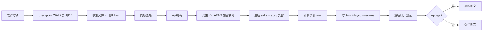

# SysPersona 安全与加密规范（v1.0）

> 状态：**v1.0（条款冻结）** · 范围：M4 安全层 · 更新：2026-11-04
> 本文是**规范**，不是实现说明。任何语言、任何加密库、任何存储后端，只要满足本文的 MUST/ MUST NOT，即可互操作。
> 条款是否**被本仓库验证过**，见[附录 F](#附录-f--条款状态与证据)；一致性声明方法见 [`CONFORMANCE.md`](CONFORMANCE.md)。
> 参考实现与可行性验证见 [`SECURITY-FEASIBILITY.md`](SECURITY-FEASIBILITY.md)。

> **范围更正（2026-11-07）**：加密整体是**可选**的——Runtime 规范 §15.1 定义 `encryption_profile`：`none` / `managed` / `device`，并可随时 `seal` / `unseal` 转换。
> 本规范描述的是**启用加密之后**的容器格式与失败语义：一旦选 `managed` / `device`，`kernel` 与 `traits` **必须**加密，`state` 与 `memory` 可选。
> 选 `none` 时本规范不适用，但**必须**在 `manifest.json` 里如实声明。

**规范性关键词**：`必须 / 不得` = MUST / MUST NOT；`应当 / 不应当` = SHOULD / SHOULD NOT；`可以` = MAY。出现冲突时，以本文件为准。

---

## 0. 这份规范要解决什么

> 术语：「人格」指设定文件（规则与记忆的文件形态）；重载=重置；统一叫记忆分身。见 README「它解决什么」一节末。

M1 已经把「规则与记忆 / 模型」拆开了，但容器还是明文：任何人拿到 `persona/` 与 `memory.db`，就拿到了它的规则与记忆（记忆分身）。M4 要补的是三件事：

1. **离开本机时是密文**——整份规则与记忆（记忆分身）可以被一个口令锁住；
2. **被改动时能发现**——内核有签名，容器任意字节被改都会在写盘前失败；
3. **复制不是转移**——公开的设定文件与记忆被复制时必须生成新 UUID、新根密钥，成为另一个记忆分身；而备份恢复恢复的是同一份规则与记忆（不是同一条会话）。

并且，**加密方式不写死**。AES-GCM、SM4、ChaCha20-Poly1305、TPM 封装、硬件密钥，都只是「Provider」。规范只规定：

- 哪些数据必须被保护（§4）；
- 密钥怎么派生、怎么分层（§6）；
- 密文长什么样（§7）；
- 什么时候必须拒绝启动（§9、§14）；
- 第三方 Provider 必须实现什么（§15）。

> 一句话：**铁打的规范，流水的算法。**

---

## 1. 范围与非目标

### 1.1 在范围内

- 本地静态数据的人格与记忆加密（容器格式、KDF、AEAD、签名）。
- 身份锚点与绑定（UUID、根密钥、设备因子）。
- 恢复路径（助记词、离线备份）与迁移（明文包 → 密文包）。
- 公开人格模板的签名与分叉语义。
- Provider 插件接口与算法注册表。

### 1.2 不在范围内（v1 明确不做）

- **运行中的内存保护**：解锁后数据在进程内存与明文工作目录里；本规范只保证「静止时是密文」。
- **多用户 / 共享权限**：一份容器属于一个 UUID。
- **防回滚**：旧容器可以被重新放回来（v2 用单调计数器解决）。
- **防删除**：攻击者可以删掉容器。可用性不在密码学范围内。
- **云端密钥托管、账号找回服务**：只留接口，v1 不做服务端。
- **防已控制主机的攻击者**：root / 键盘记录 / 调试器能拿到口令与明文。

---

## 2. 术语

| 术语 | 含义 |
|---|---|
| **Persona** | 人格整体：内核 + 性格结构 + 状态 |
| **Kernel** | `persona/kernel.json`：身份、价值观、边界。只有人能改 |
| **KS**（Key Seed） | 32 字节根密钥。一个 Persona 一个，终身不变（fork 除外） |
| **KEK** | 由口令（与绑定因子）派生出的密钥，只用于包裹 KS |
| **VK** | 内容密钥，由 KS + 容器盐派生，用于加密载荷 |
| **Container** | `.sysvault` 文件：头部 + 载荷密文 |
| **Wrap** | 用某个因子（口令 / 助记词 / 设备密钥）加密 KS 的结果 |
| **Seal / Unseal** | 封装（明文 → 容器）/ 解封（容器 → 明文） |
| **Fork** | 从公开模板生成新人格：新 UUID、新 KS、空记忆 |
| **Provider** | 提供 KDF / AEAD / MAC / 签名的插件实现 |

---

## 3. 威胁模型

### 3.1 假设

- 攻击者可以拿到容器文件、备份、旧快照，以及磁盘镜像；
- 攻击者知道格式（Kerckhoffs 原则），只缺密钥；
- 用户口令**可能**很弱，因此 KDF 必须内存硬、可调参；
- 攻击者可以修改容器任意字节，可以换一台机器打开；
- 合法用户可能在多台设备间搬运（备份恢复）或复制公开的设定文件与记忆（fork）。

### 3.2 安全声明与依据

| 攻击 | 结果 | 依据 |
|---|---|---|
| 拿到容器，离线猜口令 | 每次猜测都要付出 KDF 成本（≥ 19 MiB 内存） | §6.2、§19 |
| 改任意一个字节 | 解密/验签失败，拒绝启动 | §7.5、§9 |
| 只改头部元数据（版本、时间戳等） | 头部 MAC 失败 | §7.4 |
| 改 KDF / wrap / 绑定的头部字段 | 密钥派生或解包失败（`E_UNLOCK`） | §6.4、§7.3 |
| 把内核换成别的 | 内核签名失败 | §9 |
| 把容器拷到另一台机器 | 设备绑定失败（绑定模式非 none 时） | §6.4 |
| 降级成明文包导入 | 默认拒绝，需显式 `--allow-plaintext` | §14.2 |
| 重放旧容器 | **不防**（v1 局限） | §21 |
| 读取运行中的内存 / 交换文件 | **不防** | §21 |

### 3.3 不提供的保证

本规范**不**声称：能抵抗已控制操作系统的人、能抵抗内存取证、能保证删除后不可恢复、能防止流量分析（容器大小、时间戳、persona id 仍是明文）。

---

## 4. 加密范围：双轨制

人格是基因，必须锁；记忆是经历，可以选择公开或私有。因此加密不是一刀切，而是**两条轨道 + 显式开关**。

| 数据 | 默认 | 可否明文 | 说明 |
|---|---|---|---|
| `persona/kernel.json` | 密文 | **否** | 内核是身份与边界，强制加密 |
| `persona/traits.json` | 密文 | **否** | 性格结构是核心资产，强制加密 |
| `persona/state.json` | 密文 | 可以 | 情绪/关注变化快，允许 `encryption.state = "plaintext"` 换取低延迟 |
| `memory.db` | 密文 | 可以 | `encryption.memory = "none"` 时允许明文，但必须打印警告并在清单里记录 |
| `config.json` | 明文 | 是 | **不得**存放密钥、口令、API Key；只放模型名与策略 |
| `snapshots/` | 随源 | 随源 | 快照与源数据同一策略 |
| 导出容器 | 密文 | 需显式 | `--no-encrypt` 必须同时 `--i-understand` |
| 公开模板 | 明文 + 签名 | 是 | 只含人格，不含记忆（§13） |

**策略存放**：`config.json` 的 `encryption` 段：

```json
{
  "encryption": {
    "persona": "required",
    "memory": "required",      // "required" | "none"
    "state": "sealed",         // "sealed" | "plaintext"
    "require_encryption": true // 全局闸门；为 true 时拒绝对明文包做任何导入
  }
}
```

- `persona` 只能是 `"required"`；写 `"none"` 必须直接报 `E_POLICY`。
- `require_encryption=true` 时，任何「明文落盘」操作都必须失败。
- 策略本身不是秘密，但**变更必须写入审计**（§14.5）。

---

## 5. 身份

### 5.1 UUID

- 每个人格一个 UUID v4，写在 `kernel.id`。
- **克隆 = 新生**：从公开模板或他人副本 fork 时，必须生成新 UUID，并记录 `kernel.meta.forked_from`。
- **恢复 ≠ 克隆**：从自己的备份恢复时，UUID 与 KS 保持不变。

### 5.2 标识的分层

| 标识 | 作用 | 何时变 |
|---|---|---|
| `persona.id` | 它属于谁（身份） | 仅 fork 时 |
| `container_id` | 这一次封装（防混用） | 每次封装 |
| `kdf.salt` | 抵抗彩虹表 | 每次封装 / 改口令 |
| `content.salt` | 派生 VK / 签名密钥 | 每次封装（恢复时可变） |
| KS | 根密钥 | 仅 fork 时 |

### 5.3 复制与转移的区别（必须实现）

| 操作 | UUID | KS | 记忆 | 语义 |
|---|---|---|---|---|
| `restore`（自己的备份） | 不变 | 不变 | 完整恢复 | 同一个它，换了地方 |
| `move`（换设备） | 不变 | 不变 | 完整 | 同一个它，换了躯壳 |
| `fork`（公开模板） | **新** | **新** | **空** | 同一个模板，另一个它 |

> 未启用设备绑定时，`move` 与「别人拷走整个目录」在密码学上不可区分。这正是设备绑定存在的原因（§6.4）。

---

## 6. 密钥体系

### 6.1 信封模型

```
口令 ──KDF(salt, params)──► KEK ──AEAD──► 包裹 KS
助记词 RS ──HKDF──► RK ──────AEAD──► 包裹 KS
设备密钥 ──HKDF──► DK ────────AEAD──► 包裹 KS（可选）

KS ──HKDF(content.salt, "…/content")──► VK ──AEAD──► 载荷（zip）
KS ──HKDF(content.salt, "…/header")───► K_hdr ──HMAC──► 头部 mac
KS ──HKDF(content.salt, "…/kernel")───► K_kernel ──HMAC──► 内核签名
```

要点：

- **KS 只以密文形式存在**（在 wraps 里）。容器头部没有明文密钥。
- **改口令只重包 KS**，不重加密载荷：`kdf.salt` 变、wrap 变、头部 mac 变，而 `payload` 逐字节不变。
- **换设备绑定只重包**，同理。
- **销毁 = 删除所有 wrap**：没有 KS，载荷就是随机噪声（crypto-shredding）。

### 6.2 KDF

必须使用内存硬 KDF。v1 注册两个：

| profile | 算法 | 参数 | 用途 |
|---|---|---|---|
| `argon2id-low` | Argon2id | m=19456 KiB, t=2, p=1 | 低端设备、树莓派 |
| `argon2id-mid` | Argon2id | m=65536 KiB, t=3, p=1 | 默认 |
| `argon2id-high` | Argon2id | m=262144 KiB, t=4, p=1 | 工作站 |
| `scrypt-low` | scrypt | N=32768, r=8, p=1 | 无 Argon2 实现时的后备 |

- 输出长度必须是 32 字节。
- `kdf.salt` 必须是 16–32 字节随机值，每次封装/改口令重新生成。
- 头部的 `params` 是**权威值**；`profile` 只是提示。实现必须按 `params` 重算，参数不认识则 `E_UNSUPPORTED`。
- 实现**可以**提高参数，但不得低于上表；降低必须显式配置并警告。

### 6.3 域分离字符串（必须逐字一致）

| 用途 | HKDF info |
|---|---|
| 内容密钥 VK | `syspersona/v1/content` |
| 头部 MAC | `syspersona/v1/header` |
| 内核签名 | `syspersona/v1/kernel` |
| 恢复密钥 | `syspersona/v1/recovery` |
| 设备因子 | `syspersona/v1/device` |

HKDF 一律为 HKDF-SHA256，`salt` 按 §7 指定，输出 32 字节。

### 6.4 绑定因子

`binding.mode`：

| 模式 | 因子来源 | 强度 | 说明 |
|---|---|---|---|
| `none` | 无 | — | 默认；只靠口令 |
| `device` | 设备指纹（主板/CPU/MachineGuid 的 SHA-256） | 低 | 挡「随手拷走」，挡不住有备而来的人 |
| `device-key` | OS 密钥库里的 32 字节随机密钥（DPAPI/Keychain/libsecret） | 高 | 推荐的生产形态；硬件损坏需走恢复 |
| `account` | 账号服务验证的第二因子 | 中 | v1 只预留 id，不定义协议 |

**绑定必须混入 KDF 输入，而不是解密后再比较**：

```
material = UTF-8(passphrase) || 0x00 || binding_factor    （binding != none 时）
```

这样「口令错」和「设备错」走同一条失败路径，不产生可区分的预言机。`binding_factor` 由 §6.3 的 `device` info 派生，32 字节。

### 6.5 密钥轮换

| 操作 | 重包 | 重加密载荷 | 何时用 |
|---|---|---|---|
| 改口令 | 是 | **否** | 定期 / 怀疑泄露 |
| 改绑定 | 是 | **否** | 换设备 |
| 轮换 KS（rekey） | 是 | **是** | 怀疑 KS 泄露；等价于重新封装全部数据 |
| 撤销助记词 | 删除 recovery wrap 并重算 mac | 否 | 助记词泄露但口令未泄露 |

---

## 7. 容器格式 v1

### 7.1 字节布局（大端）

| 偏移 | 长度 | 字段 | 说明 |
|---|---|---|---|
| 0 | 8 | `magic` | ASCII `SPVAULT1` |
| 8 | 2 | `version` | uint16 = 1 |
| 10 | 2 | `header_len` | uint16，header 字节数 |
| 12 | `header_len` | `header` | UTF-8 规范化 JSON（§8） |
| 12+header_len | 4 | `payload_len` | uint32，密文字节数 |
| 16+header_len | `payload_len` | `payload` | AES-256-GCM 密文 ‖ 16 字节 tag |

约束：

- `header_len` ≤ 65535，且实现应当限制在 64 KiB；
- `payload_len` ≤ 2³⁰（1 GiB），更大时用 v2 分块格式；
- 文件**不得**有尾部多余字节；截断或追加都必须 `E_FORMAT`；
- 版本号不匹配必须 `E_UNSUPPORTED`，**不得**猜测兼容。

### 7.2 头部字段

| 字段 | 类型 | 必须 | 含义 |
|---|---|---|---|
| `format` | string | 是 | 固定 `syspersona-vault/1` |
| `container_id` | string | 是 | UUID v4，每次封装新生成 |
| `created_at` | string | 是 | RFC 3339 带时区 |
| `persona.id` | string | 是 | 人格 UUID |
| `persona.version` | string | 是 | 人格版本 |
| `persona.kernel_sha256` | string | 是 | 内核规范化字节的 SHA-256（小写 hex） |
| `kdf.id` | string | 是 | `argon2id` / `scrypt` |
| `kdf.profile` | string | 否 | 参数档位提示 |
| `kdf.salt` | b64u | 是 | 16–32 字节 |
| `kdf.params` | object | 是 | 算法参数（权威） |
| `binding.mode` | string | 是 | `none` / `device` / `device-key` / `account` |
| `content.alg` | string | 是 | `aes-256-gcm` |
| `content.salt` | b64u | 是 | 32 字节 |
| `content.nonce` | b64u | 是 | 12 字节 |
| `wraps` | array | 是 | ≥1 个 wrap |
| `wraps[].id` | string | 是 | `passphrase` / `recovery` / `device` / `escrow` |
| `wraps[].alg` | string | 是 | `aes-256-gcm` |
| `wraps[].nonce` | b64u | 是 | 12 字节 |
| `wraps[].ct` | b64u | 是 | KS 密文 ‖ tag（48 字节） |
| `recovery` | object | 否 | `{scheme:"bip39", words:24, wrap:"recovery"}` |
| `mac` | b64u | 是 | 头部 MAC，32 字节 |

未知的顶层字段：`x-` 前缀的忽略；其余必须 `E_UNSUPPORTED`（防止扩展悄悄削弱策略）。

### 7.3 认证边界（AAD）

| 对象 | AAD |
|---|---|
| wrap | `"SPVAULT1" ‖ 0x0001 ‖ "|wrap|" ‖ wrap_id`（ASCII） |
| payload | `"SPVAULT1" ‖ 0x0001 ‖ "|payload|" ‖ container_id ‖ "\|" ‖ content.salt(b64u) ‖ "\|" ‖ persona.id` |
| header | HMAC 覆盖整个头部（除 `mac` 自身） |

设计要点：

- **payload AAD 只包含不可变字段**，所以改口令/改绑定时载荷不用重加密（§6.5）。
- **头部 MAC 覆盖元数据**，所以改 `persona.version`、`created_at`、`kdf` 等都会失败。
- wrap 的 AAD 绑定 wrap 身份，防止把 recovery wrap 挪到 passphrase 位置。

### 7.4 头部 MAC

```
K_hdr  = HKDF-SHA256(KS, salt = content.salt, info = "syspersona/v1/header", L=32)
header.mac = HMAC-SHA256(K_hdr, canonical(header 去掉 mac))
```

验证时机：解出 KS **之后**、解密载荷**之前**。

### 7.5 Nonce 规则

- 所有 nonce 必须是 12 字节 CSPRNG 随机值，**不得**复用；
- 同一封装里每个 wrap 一个 nonce，载荷一个 nonce；
- 每次重新封装必须换 `content.salt` 与所有 nonce；
- 实现应当拒绝「同一密钥下重复 nonce」的容器（可在测试模式检查）。

### 7.6 载荷

载荷是 ZIP（deflate 或 store）压缩包，至少包含：

```
manifest.json
persona/kernel.json
persona/traits.json
persona/state.json        （若密封）
memory.db                 （若密封）
config.json
```

`manifest.json`：

```json
{
  "schema": "syspersona/manifest@1",
  "persona_id": "…",
  "persona_version": "1.4.0",
  "sealed_at": "2026-11-04T18:30:00+08:00",
  "files": [
    {"path": "memory.db", "size": 123456, "sha256": "…"}
  ],
  "kernel": {
    "sha256": "…",
    "sig": {"alg": "hmac-sha256", "value": "b64u…"}
  }
}
```

- 路径必须是 POSIX 相对路径；不得以 `/` 开头或含 `..`；
- 解包时必须逐文件校验 `sha256` 与 `size`；
- 解包到暂存目录，全部校验通过后再原子替换，**不得边解边写目标目录**。

---

## 8. 规范化 JSON（规范字节）

签名与 MAC 依赖字节级一致，因此定义：

1. 只允许 `null` / `true` / `false` / 整数 / 字符串 / 数组 / 对象；
2. **禁止浮点数**（`1.0` 也不行）、禁止 `-0`、禁止指数形式；
3. 字符串必须是 **NFC**；
4. 对象键按 Unicode 码点升序排序；
5. 分隔符为 `,` 与 `:`，**无空格**；
6. 输出 UTF-8，非 ASCII 字符不转义（`ensure_ascii=false`）；
7. 转义只用于 `"`、`\` 与控制字符（RFC 8259 最小转义），控制字符用 `\u00xx` 小写。

Python 等价实现：`json.dumps(obj, ensure_ascii=False, sort_keys=True, separators=(",", ":"))`；JavaScript 需要递归排序后 `JSON.stringify`。

---

## 9. 内核签名

### 9.1 签名对象

```
signed_body = canonical(kernel 的子集：schema / id / version / kernel)
kernel.sha256 = SHA-256(signed_body)
kernel.sig    = HMAC-SHA256(K_kernel, signed_body)
K_kernel      = HKDF-SHA256(KS, content.salt, "syspersona/v1/kernel", 32)
```

只签子集，不签 `traits` 与 `state`——后两者按设计会演化，签了就会每次睡眠都要求人工批准。

### 9.2 算法

| alg | 状态 | 说明 |
|---|---|---|
| `hmac-sha256` | v1 必须 | 共享密钥，验证者必须能解锁容器 |
| `ed25519` | v1 可选 | 用于公开模板；公钥可公开，任何人可验 |

私有容器用 HMAC 足够：能验签的人本来就能解密。公开模板必须用 Ed25519（否则第三方无法验证）。

### 9.3 签名时机与批准

- 封装时自动重签；
- **但内核内容变化必须先获得显式批准**：实现必须记住上一次封装的 `kernel_sha256`；不一致且未带 `--approve-kernel-change` 时，必须 `E_POLICY` 拒绝。
- 这条规则是 M1「kernel 只有人能改」的密码学补强：自动流程无法悄悄改写内核后再重签。

### 9.4 验证

解包后、写盘前，必须：

1. 重新计算 `signed_body` 的 hash，与 `manifest.kernel.sha256` 比较；
2. 重新计算 HMAC / 验证 Ed25519；
3. 任一不符 → `E_SIGNATURE`，**拒绝启动**，不得降级为「只读模式」或「忽略签名」。

> 签名不能防「持有 KS 的人」——他能重签。它防的是：损坏、跨实现写错、以及**没有签名密钥的第三方**替换内核。这是完整性，不是授权。

---

## 10. 记忆库：SQLite 的特殊约束

SQLite 的明文不只在 `memory.db` 里，这是验证阶段实测到的（见可行性报告 M3/M4）：

| 位置 | 风险 | 封装前必须做的事 |
|---|---|---|
| `memory.db-wal` | 已提交但未 checkpoint 的明文 | `PRAGMA wal_checkpoint(TRUNCATE)`，再关闭连接 |
| `memory.db-shm` | 共享内存索引 | 关闭连接后删除 |
| `memory.db-journal` | 回滚日志明文 | 确保无未完成事务后删除 |
| 已删除行 | 空页里仍有明文 | 删除敏感行后 `VACUUM`（可选，代价是重写整库） |
| 临时文件 | `ORDER BY` 等可能落盘 | 设 `PRAGMA temp_store=MEMORY` |

因此封装流程**必须**：

1. 取得单写者锁（§17）；
2. `wal_checkpoint(TRUNCATE)`；
3. 关闭所有连接；
4. 收集 `memory.db`（及必要时的 `-wal/-shm`，但正常应为空）；
5. 封装完成后，才允许删除明文（`--purge`）。

**运行中的边界**：v1 采用「睡着时是密文」——运行时明文在工作目录，睡眠/退出时封装。这不是缺陷，是明确的取舍；真正的「运行时加密」需要加密文件系统或页级加密（v2）。

---

## 11. 生命周期

### 11.1 封装（seal）



- 输出必须**原子替换**：同目录临时文件 → fsync → rename；
- 封装后应当重新打开容器、解头部、校验 mac（不必解全量载荷）；
- 只有 `--purge` 才删除明文；默认保留，便于回滚。

### 11.2 解锁（unlock）

顺序不可交换：

1. 校验 magic / version / 长度；
2. 解析头部 JSON（限制深度与大小）；
3. 算法注册表检查（**在 KDF 之前**，未知算法直接失败）；
4. KDF；
5. 解 wrap 得到 KS；
6. 校验头部 mac；
7. 解密载荷（AEAD）；
8. 解 zip、逐文件校验 hash；
9. 校验内核签名；
10. 解到暂存目录 → 原子替换目标目录。

任一步失败：不写目标目录、删除暂存、返回统一错误。

### 11.3 唤醒时长

解锁是启动路径的一部分，预算见 §19。KDF 参数按设备档位选择，不按「越慢越好」——太慢会诱使用户关掉加密。

---

## 12. 恢复

### 12.1 三条路径

| 路径 | 机制 | 代价 | v1 状态 |
|---|---|---|---|
| 助记词 | 32 字节 RS → BIP39 24 词；RS 包裹 KS | 纸张泄露 = 容器可开 | 必须 |
| 离线备份 | 容器副本（多份、异地） | 需要纪律 | 必须（流程，不是新格式） |
| 托管找回 | 服务端持有 escrow wrap | 牺牲零知识 | 只留接口 |

### 12.2 助记词规则

- RS 必须是 32 字节 CSPRNG；**不得**直接编码 KS（否则无法撤销）；
- 恢复 wrap：`RK = HKDF-SHA256(RS, salt="", info="syspersona/v1/recovery", 32)`；
- `wrap.id = "recovery"`，AAD 同 §7.3；
- 助记词只在生成时显示一次，**不得**落盘、不得进日志、不得进 shell history；
- 抄错一个词必须被 BIP39 校验位发现（`E_MNEMONIC`）。

### 12.3 恢复能做什么、不能做什么

| 能 | 不能 |
|---|---|
| 用助记词解开任何持有 RS 的容器 | 恢复已删除的容器 |
| 用备份副本恢复全部记忆 | 恢复忘记的助记词 |
| 在新设备上重建同一个 UUID | 撤销已被拷贝走的 KS（只能 rekey） |

### 12.4 撤销

- 删除 recovery wrap 并重算头部 mac → 助记词立即失效；
- 怀疑 KS 泄露 → `rekey`：新 KS、新 salt、全量重加密、旧容器作废；
- 删除所有 wrap → 数据永久不可解（crypto-shredding），必须二次确认。

---

## 13. 公开模板与分叉

### 13.1 模板格式

```json
{
  "schema": "syspersona-template/1",
  "publisher": {"persona_id": "…", "ed25519_public": "b64…"},
  "persona": {"id": "…", "version": "1.4.0", "kernel": {…}, "traits": {…}},
  "visibility": "public",
  "license": "MIT",
  "created_at": "…",
  "signature": {"alg": "ed25519", "value": "b64…"}
}
```

- 签名对象 = `canonical(去掉 signature 的整个对象)`；
- 模板**不得**包含 `memory.db`、`state.json`、任何密钥；
- 导入时必须验签；验签失败 → `E_SIGNATURE`。

### 13.2 分叉语义（必须）

1. 生成新 UUID v4；
2. 生成新 KS 与新 salt；
3. **记忆为空**（模板本来就没有记忆）；
4. 在 `kernel.meta` 记录 `forked_from`、`forked_at`、`source`；
5. 原模板保持不变。

> 复制即新生：同一个模板，不同的主人、不同的记忆，从此走向不同的结果。

### 13.3 模板的信任模型

签名只证明「谁发布」，不证明「内容安全」。导入方仍应显示模板摘要与发布者，供人确认。

---

## 14. 失败语义

### 14.1 统一错误

| 码 | 含义 | 用户可见文案 |
|---|---|---|
| `E_FORMAT` | 不是容器 / 截断 / 长度非法 | 文件格式不正确 |
| `E_UNSUPPORTED` | 版本或算法不认识 | 此版本无法打开（算法不支持） |
| `E_UNLOCK` | 口令/设备/助记词不对，或 wrap 缺失 | **保险库无法打开** |
| `E_INTEGRITY` | AEAD / MAC / 文件 hash 失败 | 数据完整性校验失败 |
| `E_SIGNATURE` | 内核或模板签名无效 | 内核签名无效，拒绝启动 |
| `E_POLICY` | 策略拒绝（明文导入、未批准的内核变更） | 操作被策略拒绝 |
| `E_MNEMONIC` | 助记词格式/校验位错误 | 助记词不正确 |
| `E_IO` / `E_BUSY` | IO 失败 / 被占用 | — |
| `E_CRYPTO` | Provider 内部失败 | — |

### 14.2 不泄露差异

- `E_UNLOCK` 必须在**所有**「打不开」场景下使用同一文案，不得区分：
  - 口令错、设备不对、wrap 不存在、KS 解出来是垃圾；
- 必须先跑 KDF，再做任何可区分的判断（防时序侧信道）；
- 不得提示「还差一点」「口令长度不对」。

### 14.3 明文导入默认拒绝

明文 `.syspersona`（v0.7 zip 包）只能通过 `import --allow-plaintext` 且 `require_encryption=false` 时导入；否则 `E_POLICY`。这是防降级的第一道闸。

### 14.4 退出码

- 成功 `0`；
- 任何失败 `非 0`；v1 CLI 统一用 `1`（与 M1 兼容），`E_*` 打到 stderr；
- `--json` 模式输出 `{"ok":false,"code":"E_…","message":"…"}`。

### 14.5 审计

- 成功解锁、封装、改口令、恢复、fork、策略变更，必须写审计；
- 失败解锁只记录「发生了一次失败」，不记录口令、不记录差异原因；
- 审计本身在容器内（加密）；容器外只允许写「时间 + 结果」到本地日志。

---

## 15. Provider 插件协议

规范不绑定实现。任何 Provider 必须满足本节。

### 15.1 接口（语言无关）

```
provider.id        : string          唯一标识，如 "openssl-native"
provider.version   : semver
provider.algorithms: [alg_id…]       声明支持的算法

derive_key(kdf_id, passphrase_material, salt, params) -> 32 bytes
aead_seal(aead_id, key, nonce, aad, plaintext) -> ciphertext||tag
aead_open(aead_id, key, nonce, aad, ciphertext||tag) -> plaintext | error
mac(mac_id, key, message) -> bytes
sign(sig_id, key, message) -> bytes            （可选）
verify(sig_id, public_key, message, sig) -> bool（可选）
```

Python 示意：

```python
class Provider(Protocol):
    id: str
    version: str
    algorithms: set[str]

    def derive_key(self, kdf_id: str, material: bytes, salt: bytes, params: dict) -> bytes: ...
    def aead_seal(self, aead_id: str, key: bytes, nonce: bytes, aad: bytes, plaintext: bytes) -> bytes: ...
    def aead_open(self, aead_id: str, key: bytes, nonce: bytes, aad: bytes, blob: bytes) -> bytes: ...
    def mac(self, mac_id: str, key: bytes, message: bytes) -> bytes: ...
```

### 15.2 绑定规则

1. **算法选择只能来自容器头部的 `alg` 字段**，且必须在注册表里；
2. 不得静默降级；找不到算法 → `E_UNSUPPORTED`；
3. 不得从容器内容加载 Provider（防代码注入）；
4. Provider 不得联网（v1）；不得写日志中的密钥材料；
5. Provider 必须可被**同一进程内**调用；跨进程 provider 可以用，但必须自担密钥经过 IPC 的风险（见可行性报告）；
6. 所有长度、参数必须校验；错误必须转成 `E_CRYPTO`，不得泄漏内部状态。

### 15.3 错误处理

Provider 内部异常必须被包装为 `E_CRYPTO` / `E_INTEGRITY`，且**不得**附带可用于区分「口令错 vs 数据坏」的细节。

---

## 16. 算法注册表

| id | 类型 | 状态 | 参数 | 备注 |
|---|---|---|---|---|
| `argon2id` | KDF | 必须（推荐默认） | m/t/p | 无原生库时用 `scrypt` 后备 |
| `scrypt` | KDF | 必须（后备） | N/r/p | 标准库可用（`hashlib.scrypt`） |
| `pbkdf2-sha256` | KDF | 弃用 | 迭代次数 | 只允许读旧数据，不得新写 |
| `aes-256-gcm` | AEAD | 必须 | 12B nonce, 16B tag | 本规范默认 |
| `xchacha20-poly1305` | AEAD | 可选 | 24B nonce | 移动端省电场景 |
| `sm4-gcm` | AEAD | 可选 | 12B nonce | 国密合规场景 |
| `hmac-sha256` | MAC | 必须 | — | 内核签名默认 |
| `ed25519` | SIG | 公开模板必须 | — | 发布者身份 |

新增算法只需：注册 id、实现 §15.1 接口、补 KAT、在容器里写对 `alg`。**不需要改核心格式。**

---

## 17. 原子性、并发与崩溃

- **单写者**：封装/解锁期间持有 `vault.lock`（PID + 时间戳 + 随机数）。第二个进程必须 `E_BUSY`，不得并行写。
- **原子替换**：临时文件写同目录 → `fsync(file)` → `rename`；目录也应当 `fsync`（支持的平台）。
- **崩溃恢复**：
  - 崩溃在 rename 之前：旧容器完好，`.tmp` 残留（下次清理）；
  - 崩溃在 rename 之后：新容器生效；
  - 崩溃在删除明文之前：明文仍在（见 §21）。
- **解锁失败**：不得留下部分明文、不得修改容器、不得「修复」。
- **暂存目录**：必须与目标同卷；失败时删除；不得使用系统临时目录（可能被其他用户读到）。

---

## 18. 版本与兼容

- 容器 `format = syspersona-vault/1`；`version` 字段为 1。
- 读取方遇到更高 `version` 必须拒绝（`E_UNSUPPORTED`），不得「尽力解析」。
- 新增可选头部字段：`x-` 前缀可忽略；非 `x-` 前缀必须拒绝。
- 明文包（v0.7 zip）识别：文件头 `PK\x03\x04`；必须先确认清单 `schema = syspersona/bundle@1`。
- 迁移是单向的：明文 → 密文。回滚靠保留的明文副本，不靠格式降级。

---

## 19. 性能预算

目标：解锁不应当让用户想关掉加密。

| 设备档 | KDF 档位 | 容器上限 | 解锁目标（含 AEAD） |
|---|---|---|---|
| low（4 线程 / 8G） | `argon2id-low` | 256 KiB | ≤ 600 ms |
| mid（8–16G） | `argon2id-mid` | 4 MiB | ≤ 1.2 s |
| high（32G+） | `argon2id-high` | 32 MiB | ≤ 2.5 s |

实测（Windows，Python 3.12 + OpenSSL 3.5，见可行性报告）：

- `argon2id-low` 108 ms，`argon2id-mid` 221 ms，`scrypt-low` 157 ms；
- AES-256-GCM 约 1.9–2.4 GB/s（原生），因此 1 MiB 载荷的加解密 < 2 ms；
- 头部固定开销约 730 B；
- 瓶颈在 KDF，不在 AEAD；**KDF 参数应当按设备档位选，而不是一味调高**。

---

## 20. 一致性测试与验收

### 20.1 已知答案测试（KAT）

附录 B 给出 KDF / HKDF / AES-GCM / HMAC / 规范化 JSON / BIP39 的固定向量。任何实现必须跑通，否则不得声称兼容。

### 20.2 负向测试矩阵（必须）

| # | 用例 | 期望 |
|---|---|---|
| N1 | 错口令 | `E_UNLOCK`，文案与设备错一致 |
| N2 | 改载荷任意字节 | `E_INTEGRITY` |
| N3 | 改头部元数据（版本/时间戳） | `E_INTEGRITY`；改 KDF 字段则为 `E_UNLOCK` |
| N4 | 改 wrap 密文 | `E_UNLOCK` |
| N5 | 截断 / 追加字节 | `E_FORMAT` |
| N6 | 未知 KDF / AEAD | `E_UNSUPPORTED` |
| N7 | 改内核 | `E_SIGNATURE` |
| N8 | 未批准的内核变更 | `E_POLICY` |
| N9 | 换设备 | `E_UNLOCK` |
| N10 | 明文包默认导入 | `E_POLICY` |
| N11 | 模板被改 | `E_SIGNATURE` |
| N12 | 助记词错一个词 | `E_MNEMONIC` |
| N13 | 旧口令在改口令后 | `E_UNLOCK` |
| N14 | 容器内明文扫描 | 无命中 |

### 20.3 验收标准（对应 HANDOFF 第六节，属于 M4 实现验收，不是本文的一致性门槛）

1. 错口令 → 无法解密，且不泄露「差一点就对」的信息；
2. 篡改任意字节 → `verify` 与 `import` 都失败并退出非 0；
3. 用备份恢复后，`memory.db` 内容哈希一致；
4. CI 增加「加密 → 解密 → 断言」一段（已实现：`.github/workflows/encryption.yml`）；
5. 内核被改 → 拒绝启动，而不是降级。

---

## 21. 已知局限（必须写进用户文档）

1. **不防回滚**：旧容器可以被放回来。v2 用单调计数器 + 可信时间源。
2. **不防运行中攻击**：解锁后明文在磁盘与内存；交换分区、休眠文件、崩溃转储都可能含明文。建议开启全盘加密。
3. **内存清零不可靠**：Python/GC 无法保证密钥被覆盖；对高威胁场景应使用原生 Provider 的安全内存。
4. **临时明文**：解封写暂存目录后原子替换，崩溃可能留下明文。
5. **元数据可见**：容器大小、`persona.id`、版本、时间戳是明文；这本身会泄露「它是谁、什么时候动过」。
6. **设备指纹可伪造**：`device` 模式只防随手拷贝；真正强度来自 `device-key`（OS 密钥库）。
7. **无抗拒绝服务**：删文件、写满磁盘、损坏容器都不在密码学范围内。
8. **纯标准库无法提供 AEAD**：Python 标准库没有 AES-GCM，M4 需要一个 Provider（见可行性报告 §6）。

---

## 22. 开放问题

- 大容器（> 1 GiB）的分块格式与随机访问；
- `memory.db` 增量封装（只重写变化页）而不是整包重加密；
- TPM / Secure Enclave 作为 KEK 的直接持有者；
- 抗回滚计数器放在哪里（TPM NV / 服务器 / 文件）；
- 多设备共享同一份规则与记忆（同一记忆分身）时的密钥同步（当前是「搬运」，不是「同步」）；
- 模板的信任链（发布者公钥如何分发、撤销）。

---

## 附录 A · 头部示例

```json
{
  "format": "syspersona-vault/1",
  "container_id": "0f8fad5b-d9cb-469f-a165-70867728950e",
  "created_at": "2026-11-04T18:30:00+08:00",
  "persona": {
    "id": "9f2b1c3d-4e5f-4a6b-8c7d-0e1f2a3b4c5d",
    "version": "1.4.0",
    "kernel_sha256": "b940d2904a3a5a4c1a1e9a2b8c0f3d7e6a5b4c3d2e1f0a9b8c7d6e5f4a3b2c1d"
  },
  "kdf": {
    "id": "argon2id",
    "profile": "argon2id-low",
    "salt": "AAECAwQFBgcICQoLDA0ODw",
    "params": {"memory": 19456, "passes": 2, "parallelism": 1}
  },
  "binding": {"mode": "none"},
  "content": {
    "alg": "aes-256-gcm",
    "salt": "q1w2e3r4t5y6u7i8o9p0asdfghjklzxcvbnm1234567890",
    "nonce": "MDEyMzQ1Njc4OWFi"
  },
  "wraps": [
    {"id": "passphrase", "alg": "aes-256-gcm", "nonce": "YWJjZGVmZ2hpamts", "ct": "…"},
    {"id": "recovery", "alg": "aes-256-gcm", "nonce": "bW5vcHFyc3R1dnd4", "ct": "…"}
  ],
  "recovery": {"scheme": "bip39", "words": 24, "wrap": "recovery"},
  "mac": "…"
}
```

（示例中的 salt/nonce/ct 是为了展示形状，不代表真实值。）

---

## 附录 B · KAT 向量

完整机器可读文件：`impl/m4/feasibility/kat.json`。摘要：

| 向量 | 输入 | 期望 |
|---|---|---|
| HKDF-SHA256（RFC 5869 Case 1） | ikm=`0b`×22, salt=`00..0c`, info=`f0..f9`, L=42 | `3cb25f25faacd57a90434f64d0362f2a…` |
| HMAC-SHA256 | key=`key`, msg=`The quick brown fox jumps over the lazy dog` | `f7bc83f4…2d1a3cd8` |
| AES-256-GCM 空消息 | key=0…0, nonce=0…0 | ct‖tag=`530f8afbc74536b9a963b4f1c4cb738b` |
| AES-256-GCM 16 字节零块 | key=0…0, nonce=0…0 | `cea7403d4d606b6e074ec5d3baf39d18d0d1c8a799996bf0265b98b5d48ab919` |
| BIP39 | entropy=0…0（32 字节） | `abandon` ×23 + `art` |
| 规范化 JSON | `{"b":1,"a":"×"}` | 字节 `7b2261223a22c39722…` |

---

## 附录 C · CLI 映射（v0.8.0 实现）

```text
syspersona vault seal    --home ./data --out me.vault [--recovery] [--purge] [--profile low|mid|high|scrypt]
syspersona vault verify  --file me.vault [--mnemonic-stdin]
syspersona vault inspect --file me.vault                     # 只看头部，不需要口令
syspersona vault unlock  --file me.vault --home ./data2 [--force]
syspersona vault passwd  --file me.vault
syspersona vault recover --file me.vault --out ./data3 --mnemonic-stdin
syspersona vault import  --file legacy.syspersona --home ./data4 --allow-plaintext
```

- 首次封装就是 `seal`，没有单独的 `init`；KS 在第一次封装时生成。
- `publish` / `fork`（公开模板，Ed25519）尚未实现，排在 M4.2。
- 口令**不得**通过命令行参数传递（会进 shell history / 进程列表）；必须走 TTY 或 stdin（`--passphrase-stdin`）。
- 所有命令支持 `--json`；失败退出码 `1`，错误码打在 stderr。
- `seal` 默认保留明文；`--purge` 才删（连同 `snapshots/`）。
- 等价入口：`python -m m4.vault ...`（需 `impl/` 在 `PYTHONPATH`）。

---

## 附录 D · 五个必须先回答的问题（决策记录）

| # | 问题 | 决定 | 理由 |
|---|---|---|---|
| 1 | 主密钥存在哪？ | KS 只以密文形式存在容器头部的 wraps 里；解锁后在内存；可选 OS 密钥库保存 `device-key` wrap | 没有「明文密钥文件」可偷；口令每次输入，或由系统密钥库代持 |
| 2 | 丢了怎么办？ | 助记词（BIP39 24 词）+ 离线备份；托管找回只留接口 | 两条路径都离线可验；托管牺牲零知识，v1 不默认 |
| 3 | 加密边界？ | kernel/traits 强制；state 可选；memory.db 可选（默认加密）；config 明文不含密钥 | 基因必须锁，经历可选择公开；配置只是策略 |
| 4 | 验签失败？ | 拒绝启动（fail-closed），绝不降级 | 「打不开」是安全状态；降级启动等于把人格交给攻击者 |
| 5 | 迁移？ | 明文包显式允许 → 校验 → 原子封装 → 保留明文副本 → 人工确认后删除 | 单向升级 + 可回滚；默认拒绝防降级 |

---

## 附录 E · 变更记录

| 版本 | 日期 | 变更 |
|---|---|---|
| 1.0-draft | 2026-11-04 | 首版：范围、密钥体系、容器格式、签名、恢复、模板、Provider、失败语义、KAT、验收 |
| 1.0 | 2026-11-04 | 条款冻结；新增附录 F「条款状态与证据」；配套 [`CONFORMANCE.md`](CONFORMANCE.md) 定义一致性声明方法 |
| — | 2026-11-10 | 术语统一：重载=重置、记忆分身、漂移=自然漂移；§0/§3.1/§22 指称改为"规则与记忆（记忆分身）"，技术要求未变 |

---

## 附录 F · 条款状态与证据

状态指**本仓库是否验证过**，不是第三方必须实现的范围。证据编号对应
[`../impl/m4/feasibility/results.json`](../impl/m4/feasibility/results.json)（R/M/K 前缀）与
[`../impl/m4/tests/`](../impl/m4/tests/)（N 前缀负向矩阵）。

### F.1 已验证（有测试或互操作证据）

| 条款 | 证据 |
|---|---|
| §6.2 KDF 参数与上限 | KAT（Argon2id / scrypt）+ 夹具 M1 |
| §6.3 域分离字符串 | HKDF RFC 5869 向量；R1 / R10b |
| §6.4 绑定因子（`device` 指纹） | R8a / R8b |
| §6.5 改口令只重包 KS | R10a / R10b（载荷密文逐字节不变） |
| §7.1–§7.3 字节布局与 AAD | R1–R4、N2–N6；R15（Node 独立实现读取） |
| §7.4 头部 MAC | R3b、N3 |
| §8 规范化 JSON | C1–C3 + KAT 字节向量 |
| §9 内核签名与变更批准 | R5a–R5c、N7、N8 |
| §10 SQLite 生命周期 | M3 / M4；端到端封装→解封哈希一致 |
| §11.2 解锁顺序与原子解包 | R1、N1–N5；`--force` 备份行为 |
| §12.1 离线备份 | R7（副本恢复后 `memory.db` 哈希一致） |
| §12.2 助记词 | R6a–R6e、N12；BIP39 KAT |
| §14 失败语义 | R2a / R2b、R14；N1–N14 全通过 |
| §15 Provider 边界 | 两套 provider（加密 / 向量）共用同一抽象；M2 11 项测试 |
| §19 性能预算 | M1 / M2 实测（KDF 110–220 ms，AEAD ~2 GB/s） |

### F.2 实现但未专项验证

| 条款 | 说明 |
|---|---|
| §17 单写者锁 | 代码已实现，未做并发争用与崩溃注入测试 |
| §11.1 写后自检 | 已实现（重开容器验证），未做断电注入 |
| §16 算法注册表 | 只有 `argon2id` / `scrypt` / `aes-256-gcm` / `hmac-sha256` 有实现；其余为登记项 |

### F.3 仅设计（无实现、无证据）

| 条款 | 内容 |
|---|---|
| §6.4 `device-key` / `account` | OS 密钥库与账号绑定 |
| §12.1 托管找回 | 服务端 escrow wrap |
| §13 公开模板与 fork | Ed25519 签名、复制即新 UUID |
| §21 防回滚 | 单调计数器 + 可信时间源 |
| §7.1 分块容器 | 大于 1 GiB 的流式格式 |
| §18 跨版本兼容矩阵 | 只定义了拒绝规则，未做兼容测试矩阵 |

### F.4 明确不做（v1 非目标）

运行中加密、内存清零、TPM、多设备同步、云端 embedding、账号找回服务。

> M2 的检索不在本规范内：episode 向量检索有实现与真实模型对照
> （[`../impl/m2/README.md`](../impl/m2/README.md)）；facts / 摘要向量与 rerank 仍是设计。
