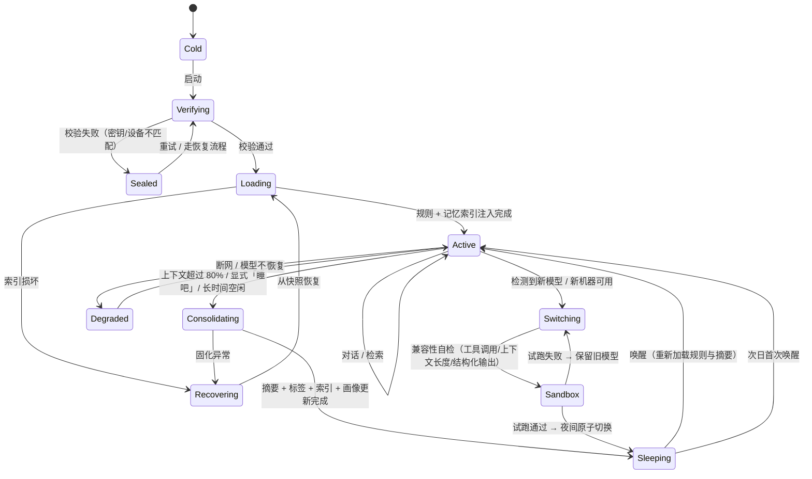
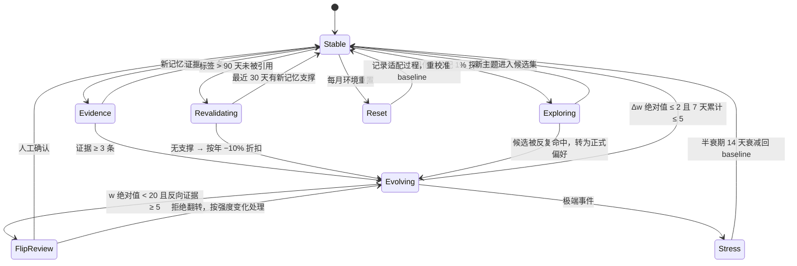
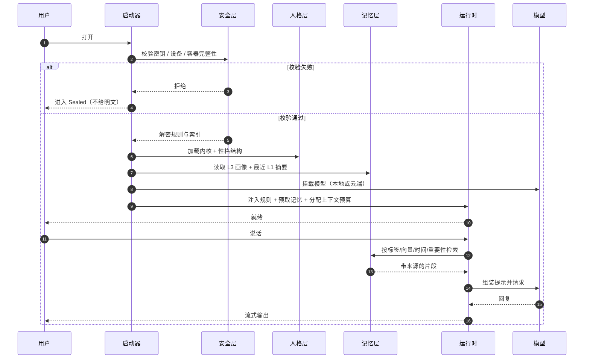

# 状态机

> **SysPersona-OS** · 本文件定义：状态机：任务四态、可跳转的关系、超期怎么处理
> 规范全文以仓库 `main` 为准；改了要同步 README / CHANGELOG / 台账。

本文件用三张图描述 SysPersona 的运行状态。图用 Mermaid 编写，GitHub 会直接渲染。

- 图 1：智能体生命周期（一次「活着 → 睡着 → 醒来 → 换机器」的循环）
- 图 2：人格权重演化（一次「证据 → 权重演化 → 再验证 → 重置」的循环）
  > **历史口径**：这是 v1.0 的模型。现行见 `PHILOSOPHY` §10.1——重载即重置，情绪/应激不写权重。
- 图 3：一次唤醒的时序（启动器做了什么）

---

## 图 1 · 智能体生命周期

要点：

- **Sealed 不是错误状态，是一个安全状态。** 密钥或设备不匹配时，系统应当「打不开」，而不是「降级打开」。
- **Consolidating 只处理归档，不处理对话。** 期间前台请求排队或降级到只读。
- **Switching 必须可回滚。** 旧模型与旧设定文件版本在切换后保留至少一个周期。

---

## 图 2 · 人格权重演化

这张图是 5.4 与 5.5 两节的合并视图：左边防「变得太快」，右边防「变得太死」。

要点：

- **Stable 是常态。** 大多数时间不应该发生任何权重变化。
- **Evolving 是唯一会改权重的状态**，且有双重闸门（单次幅度、周累计）。
- **Revalidating 只折扣、不删除。** 旧经验要重新被引用才能维持权重。
- **Exploring 只影响候选集**，不触碰内核与边界。
- **Stress 是临时状态**，不会直接改写 baseline。

---

## 图 3 · 一次唤醒的时序

要点：

- 校验在解密之前，解密在加载之前——顺序不能换。
- 记忆是「按预算预取」，不是「全量加载」；全量加载会在启动时就把上下文挤爆。
- 检索结果必须带来源，否则后续无法做冲突消解与审计。

---

## 状态与代码的对应

| 状态 | 对应模块 | 关键文件 |
|---|---|---|
| Cold / Verifying / Sealed | `launcher` + `vault` | 容器头、设备指纹 |
| Loading / Active | `runtime` | `persona.yaml`、记忆索引 |
| Consolidating / Sleeping | 后台维护进程 | `episodes`、`persona_traits` |
| Switching / Sandbox | 换机器流程 | 模型清单、测试集 |
| Degraded / Recovering | 降级与快照 | `snapshots` |

> 这些状态是**设计约定**，不是某个已发布实现的内部状态机。实现时可以合并状态，但不应跳过「校验 → 解密 → 加载」的顺序。
