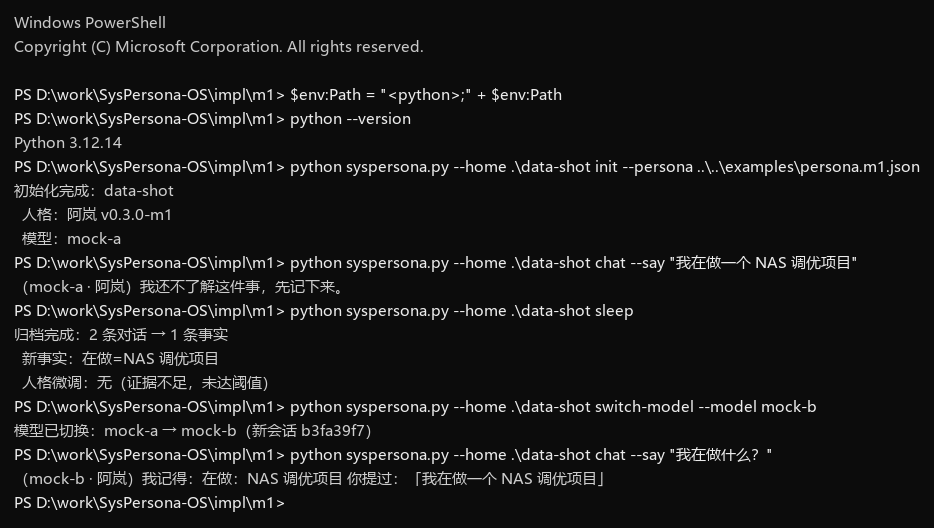

# M1 · 最小闭环

这不是产品，是**唯一目的**的验证程序：证明「人格 + 记忆 + 模型」三者可以拆开，并且换模型之后，它还记得之前的事。

- 依赖：Python 3.10+，且 `python`（或 `py -3`）在 PATH 中；**只用标准库**
- 规模：单文件约 480 行
- 模型：默认 `mock`（确定性回复），可选 `ollama:<model>`
- 包含：人格加载、对话落库、睡眠归档、**偏好微调（5.4 的简化版）**、**极性翻转闸门**、**情绪状态层**、**常驻 serve**、换模型
- 不包含：加密、设备绑定、抗僵化、向量检索、多任务调度（属 M2–M4）

## 数据布局

```
data/
├─ persona.json     人格（init 时从 examples/persona.m1.json 复制）
├─ config.json      当前模型与会话 id
├─ memory.db        SQLite：episodes / facts / profile / snapshots / audit_log
└─ snapshots/       每次归档前的快照
```

## 一次完整演示

```bash
python syspersona.py --home ./data init --persona ../../examples/persona.m1.json
python syspersona.py --home ./data chat  --say "你好，我叫黄，我在做一个 NAS 调优项目，我喜欢简洁的回答。"
python syspersona.py --home ./data sleep
python syspersona.py --home ./data switch-model --model mock-b
python syspersona.py --home ./data chat  --say "我叫什么？我在做什么？"
python syspersona.py --home ./data status
```

实际输出（Windows / PowerShell，UTF-8）：

```
（mock-a · 阿岚）我还不了解这件事，先记下来。
归档完成：2 条对话 → 3 条事实
  新事实：称呼=黄；在做=NAS 调优项目；喜欢=简洁的回答
模型已切换：mock-a → mock-b（新会话 bb00c58a）
（mock-b · 阿岚）我记得：在做：NAS 调优项目；称呼：黄
人格：阿岚  v0.1.0-m1  id=b7d1c2a4
模型：mock-b   会话：bb00c58a
记忆：4 条对话，3 条事实，2 条待归档
画像：称呼：黄；在做：NAS 调优项目；喜欢：简洁的回答
```

**关键点**：第 4 步换了模型，第 5 步它仍然答得出姓名与项目。模型只是被换掉的执行者；人格与记忆留在文件里。



## 人格微调（5.4 的简化版）

偏好不是形容词，是带权重的对象。连续三次提到「简洁」，睡眠时它自己把这条权重挪了 2 点：

```bash
python syspersona.py --home ./data chat --say "回答简洁一点。"
python syspersona.py --home ./data chat --say "我喜欢简洁的回答。"
python syspersona.py --home ./data chat --say "以后都简洁些。"
python syspersona.py --home ./data sleep
python syspersona.py --home ./data status
```

```
归档完成：6 条对话 → 1 条事实
  新事实：喜欢=简洁的回答
  人格微调：pref_short 80 → 82（证据 3 条）
...
偏好：简洁的回答 82（基线 80）；冗长的解释 70（基线 70）
最近漂移：pref_short 80→82（3 条记忆提及「简洁的回答」）
```

规则（对应 5.4）：

| 约束 | 这里的实现 |
|---|---|
| 触发时机 | 只在 `sleep`，对话中不改 |
| 证据门槛 | 同一偏好至少 3 条记忆提及，未达标不动 |
| 单次幅度 | `min(max_step, 0.5 × 证据数)`，默认上限 2 |
| 周累计上限 | 上行 5 点、下行 5 点**分别计算**；某个方向达上限后，该方向跳过并提示 |
| 无证据回弹 | 本轮证据不足时，向 baseline 回弹 0.5（只消耗下行额度） |
| 可追溯 | 每条变化写 `persona_drift_log`，含旧值、新值、证据数、原因 |
| 内核保护 | `kernel` 段不参与任何写入 |

第二条偏好「冗长的解释」因为没被提到，权重保持 70 —— 这正是「不相关的东西不会跟着变」。

再睡一觉、但没有相关对话时，它会往回走：

```
人格微调：pref_short 81.5 → 81.0（回归基线）
```

连续加满 5 点之后：

```
人格微调：pref_short 上行已达 7 天上限（5.0/5）
偏好：简洁的回答  84.0（基线 80.0，本周 上行 5.0/5 下行 1.0/5）
```

上行与下行是**两个独立额度**：先涨后回，不会把「涨回去」的额度用掉。

## 极性翻转闸门（5.4 的最后一块）

权重被反向证据压到死区以下，还不足以自己改主意。要同时满足三件事：

1. 权重 `< 20`（死区）
2. 反向证据 `≥ 5` 条
3. **人工批准**

`pref_longpost` 初始权重 18，连续五条「我不喜欢长篇大论」之后：

```bash
python syspersona.py --home ./data sleep
#   人格微调：pref_longpost 18.0 → 16.0（反向 5 条）；已生成极性翻转待确认 #1

python syspersona.py --home ./data flip-review
# #1  pref_longpost  like → dislike  反向证据 5 条  2026-11-04T15:14:19+08:00

python syspersona.py --home ./data flip-review --approve 1
# 已批准：pref_longpost like → dislike（权重保持 16.0）
```

批准后 `polarity` 变、权重保持 16，`baseline` 一并改为 16——否则回弹会把它拉回旧的「喜欢」。

拒绝则保持原极性，请求标记 rejected，不再重复生成。

判定规则：

| 情形 | 行为 |
|---|---|
| 支持 ≥3，反向 <3 | 上调，消耗上行额度 |
| 反向 ≥3，支持 <3 | 下调，消耗下行额度 |
| 两边都 ≥3 | 证据冲突，不动 |
| 两边都 <3 | 向 baseline 回弹 0.5 |

## 常驻模式（验证「随时间变化」）

一次性命令只能验证链路，验证不了「几小时后脾气散了、偏移衰减了」。`serve` 让进程活着：

```bash
# 窗口 A：常驻
python syspersona.py --home ./data serve --idle-seconds 300

# 窗口 B：投递（可以随时发，不用等）
python syspersona.py --home ./data send --say "我在做一个 NAS 调优项目"
```

输出：

```
常驻中：./data
  模型：mock-a   空闲 300s 自动睡眠   Ctrl+C 停止

你：我在做一个 NAS 调优项目
它：（mock-a · 阿岚）我还不了解这件事，先记下来。

—— 空闲，进入睡眠 ——
归档完成：4 条对话 → 1 条事实
  新事实：在做=NAS 调优项目
  人格微调：无（证据不足，未达阈值）
  情绪归零（睡眠）
```

机制：轮询 `inbox.txt` 的新行 → 逐条 `respond` → 空闲超过阈值自动 `run_sleep`。情绪按真实时间衰减，所以「挂着不管」本身就是在验证衰减曲线。

## 时间加速（simulate）

等两周太慢。`simulate` 用虚拟时钟把 1 天压成 1 步，14 天几秒跑完：

```bash
python syspersona.py --home ./data simulate
# 用自己的场景
python syspersona.py --home ./data simulate --scenario ..\..\examples\scenario.14d.json
```

输出（节选）：

```
第  1 天  消息 3  pref_short=81.5  pref_verbose=70.0  pref_longpost=18.0
        人格微调：pref_short 80.0 → 81.5（支持 3 条）
第  2 天  消息 1  pref_short=81.0
        人格微调：pref_short 81.5 → 81.0（回归基线）
第  5 天  消息 3  pref_short=84.5
        人格微调：pref_short 84.0 → 84.5（支持 3 条）
第  7 天  消息 5  pref_longpost=16.0
        人格微调：pref_longpost 18.0 → 16.0（反向 5 条）；已生成极性翻转待确认 #1
第 11 天  消息 0  pref_short=82.0
        应激结算：pref_short 应激偏移已衰减，丢弃
```

关键：`now()`、时间近因、情绪衰减、应激衰减、周额度统计全部读虚拟时钟，所以断言的是真实逻辑，不是另写一套。

场景文件格式：

```json
{
  "days": [
    {"messages": ["回答简洁一点。", "我喜欢简洁的回答。"]},
    {"messages": ["今天天气不错。"]},
    {"messages": ["我不喜欢长篇大论。"], "sleep": false}
  ]
}
```

`sleep: false` 表示这一天不睡，用来验证「隔天才结算时偏移已衰减」。

### 断言

场景里可以直接写期望值，不满足就**退出码 1**：

```json
{
  "days": [
    {"messages": ["回答简洁一点。", "我喜欢简洁的回答。", "以后都简洁些。"],
     "expect": {"pref_short": 81.5}}
  ],
  "expect_final": {"pending_flips": 1}
}
```

```bash
python syspersona.py --home ./sim simulate --scenario ..\..\examples\scenario.14d.json
# 断言通过：12 条      （退出码 0）

python syspersona.py --home ./sim simulate --scenario bad.json
# 断言失败 1/2：
#   - 第 1 天：pref_short 期望 99.0，实际 81.5   （退出码 1）
```

这就是回归测试：改任何参数（幅度、半衰期、额度），跑一次就知道有没有破坏既有行为。可以直接挂进 CI。

## 状态层（当天生效，不等睡着）

第 4.1 节把人格分成三层，M1 之前只实现了前两层——所以「当天发生什么都不变」。补上状态层后：

- **脾气当场变**：每句话后情绪按 30 分钟半衰期衰减，再吸收本轮刺激（夸 → 愉悦 +6，指责 → 烦躁 +8，报错 → 专注 +6）
- **权重仍然过夜结算**：`traits` 一条都不动，直到 `sleep`

```bash
python syspersona.py --home ./data chat --say "谢谢，你这次做得不错。"
python syspersona.py --home ./data chat --say "真的很不错。"
python syspersona.py --home ./data chat --say "怎么搞的，又错了。"
```

```
（mock-a · 阿岚）我还不了解这件事，先记下来。
（mock-a · 阿岚）（心情不错）你提过：「谢谢，你这次做得不错。」
（mock-a · 阿岚）（有点烦躁，先说结论）你提过：「你又搞错了。」

情绪：愉悦 +12、烦躁 +16
偏好：简洁的回答 [like]  80.0（基线 80.0，本周 上行 0.0/5 下行 0.0/5）
```

第三句之后偏好权重**一点没动**——它只是不高兴，没有变成另一个人。等到 `sleep`：

```
  情绪归零（睡眠）
情绪：平稳
```

| 层 | 何时变 | 影响什么 |
|---|---|---|
| 状态 | 每句话 | 语气、长短、先说什么 |
| 性格 | 睡眠结算 | 权重、证据、极性 |

情绪存在 `runtime_state` 里，重启进程也不会忘；衰减按真实时间算，不是按对话轮次。

## 应激偏移（当天有变化，睡着才定论）

情绪只改语气，不改权重。但如果一句话直接指向某个偏好，它会先给权重一个**临时偏移**，几小时内自己衰减：

```bash
python syspersona.py --home ./data chat --say "我讨厌简洁的回答。"
# 偏好：简洁的回答 [like]  79.0（基线 80.0，应激 -1.0，本周 上行 0.0/5 下行 0.0/5）

python syspersona.py --home ./data sleep
#   应激结算：pref_short 80.0 → 79.0（应激并入 -1.0）
```

当天显示 79.0，但数据库里的 `weight` 还是 80——79 是「有效值」。睡着时才决定要不要写进去。

如果两次睡眠隔了 12 小时，残值只剩 `-1 × exp(-12/6) ≈ -0.14`：

```
应激结算：pref_short 应激偏移已衰减，丢弃
```

| 约束 | 值 |
|---|---|
| 单次刺激 | ±1，累计上限 ±2 |
| 衰减 | 6 小时半衰期 |
| 结算门槛 | 残值 ≥ 0.3 才并入，否则丢弃 |
| 并入额度 | 受单次上限与周额度约束 |

这样「当天就有点不一样」和「第二天才定性格」可以并存：前者可回滚，后者才沉淀。

## 抗僵化（5.5 的简化版）

防「越老越固执」，三件事：

1. **旧标签再验证**：90 天没有被新记忆支撑的偏好，权重 ×0.9；之后每满 90 天再来一次。折扣不占周额度（它不算漂移，算维护）。
2. **僵化指数**：旧偏好占比 ×0.6 + 旧事实占比 ×0.4，`status` 和月度维护时显示。
3. **探索候选 / 月度提醒**：睡眠时扫「反复出现但没被任何偏好或事实覆盖」的主题；每 30 天提示做一次环境重置。

```bash
python syspersona.py --home ./data simulate --scenario ..\..\examples\scenario.90d.json
```

```
第 90 天  消息 0  pref_short=81.5  pref_verbose=63.0  pref_longpost=16.2
        旧标签再验证：pref_verbose 70.0 → 63.0（90 天未更新）；pref_longpost 18.0 → 16.2（90 天未更新）
        [月度维护] 第 90 天：僵化指数 40/100（旧偏好 67%，旧事实 0%）  → 该做一次环境重置了
第 91 天  消息 0  pref_short=73.4  ...
        旧标签再验证：pref_short 81.5 → 73.4（90 天未更新）
```

注意 `pref_short` 比另外两条晚一天打折——它在第 1 天被支撑过，计时从那天算起。

## 检索（6.3 的简化版）

三段式打分，没有向量：

```
score = 0.6 × 词面重合 + 0.25 × 时间近因 + 0.15 × 重要性
时间近因 = exp(-天数 / 7)
```

中文按二元组切分（`简洁的回答` → 简洁/洁的/的回答/回答），英文按词切分。助手回复因为常复述用户内容，得分乘 0.7，避免检索自我强化。

单条命令可以直接看排序：

```bash
python syspersona.py --home ./data recall --query "旧机器休眠"
```

```
0.925  [user     ] 我在做一个 NAS 调优项目，主要是让旧机器休眠更稳。
```

对话里则会自动注入命中的记忆（问句被过滤掉，避免把「我问过什么」当成「我知道什么」）：

```
（mock-b · 阿岚）你提过：「我在做一个 NAS 调优项目，主要是让旧机器休眠更稳。」
```

换模型之后这条召回依然成立——检索读的是数据库，不是模型。

## 对应规范

| 规范 | 这里的实现 |
|---|---|
| 4.1 人格文件 | `init` 读取 JSON，`kernel.identity` 注入回复；版本写入 `persona_versions` |
| 6.2 写入管线 | `chat` 落库为 episode（未抽取） |
| 7.3 睡眠 | `sleep`：抽取事实 → 更新画像 → 标记已归档 → 写快照 |
| 7.5 迁移 | `switch-model`：换模型、开新会话；记忆不动 |

## 已知限制

- **人格用 JSON 而非 YAML**：避免引入 PyYAML。YAML 解析放 M2。
- **抽取是正则**：只认「我叫 / 我在做 / 我喜欢 / 我讨厌」四种句式，不是模型抽取。
- **检索是词面重合 + 时间衰减 + 重要性**：没有向量、没有语义改写、没有重排模型。
- **模拟不等于实测**：`simulate` 验证的是时间相关逻辑，不覆盖并发、进程重启、真实模型的不确定性。
- **抗僵化只做了简化版**：再验证是固定 10% 折扣，探索只出候选不新增偏好，环境重置仍需人工执行。
- **常驻是文件轮询**：`inbox.txt` 追加即处理，不是 HTTP/WebSocket；没有守护、崩溃重启、日志轮转。
- **情绪靠关键词触发**：`厉害/错了/报错` 这类规则，不是模型判断语调；维度只有四个。
- **应激靠「命中偏好对象 + 否定词」触发**：没有情绪强度建模，也没有事件显著性打分。
- **翻转审批在命令行**：没有二次确认、冷却期与「翻转后悔药」；批准即生效。
- **漂移是离散近似**：回弹用固定 0.5 步进，不是指数半衰期；抗僵化（5.5）未实现。
- **单进程**：没有后台维护、没有配额、没有热重载。
- **无加密**：`persona.json` 是明文，不要放真实隐私。

## 下一步（M2）

1. 向量检索 + 时间衰减 + 重要性重排（对应 6.3）；
2. YAML 人格解析，直接读 `examples/persona.example.yaml`；
3. 抽取改用模型（本地小模型即可），替换正则；
4. 归档时写 `persona_traits`，让偏好权重开始漂移（对应 5.4）。
